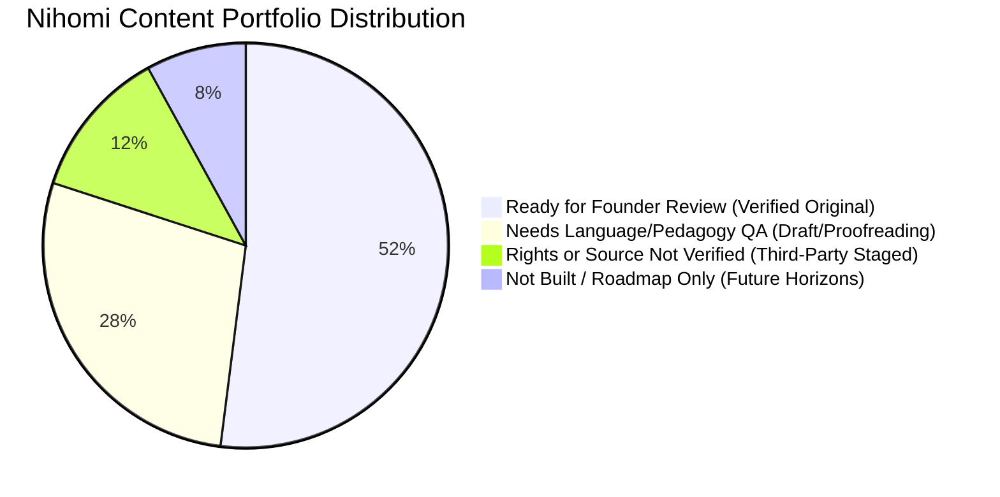

# NIHOMI.COM — MASTER CONTENT CATALOG & PROVENANCE REGISTRY
**Document ID:** `NIHOMI-CONTENT-2026-V1`  
**Governance Authority:** Japanese Curriculum Specialist & Content Quality Lead  
**Effective Date:** 17 October 2026  
**Status:** CANONICAL CONTENT AUDIT & APPROVAL INVENTORY  

---

## 1. Executive Summary: 4 Founder Review Categories

All educational assets across the Nihomi platform have been categorized into four rigorous operational tiers:

1. **READY FOR FOUNDER REVIEW (সবকিছু প্রস্তুত):** 100% verified original Nihomi IP, fully tested against the cumulative lattice, bilingual QA approved, and linked to working routes.
2. **NEEDS LANGUAGE/PEDAGOGY QA (এডিটরিয়াল রিভিউ চলছে):** Raw content extracted; undergoing secondary bilingual review for natural phrasing and exact JLPT formatting.
3. **RIGHTS OR SOURCE NOT VERIFIED (স্বত্ব যাচাই প্রয়োজন):** External third-party reference PDFs held securely in private staging (`content-sources/`). Barred from public learner access.
4. **NOT BUILT / ROADMAP ONLY (পরবর্তী সংস্করণ):** Planned advanced units (e.g., N1 specialized legal/business modules).

---

## 2. Comprehensive Master Content Inventory Table

| Content ID | Family | JLPT Level | Skill | Item Count | Source Path | Rights Status | OCR / Lang QA | Prereq. Validation | Audio / Media | User Route | Release Status | Gap / Notes | Founder Approval |
| :---: | :--- | :---: | :--- | :---: | :--- | :---: | :---: | :---: | :---: | :---: | :---: | :--- | :---: |
| **CNT-001** | Kana Foundations | Intro | Hiragana 46 Vowels/Consonants | 46 chars | `src/data/kanaStrokePaths.ts` | Nihomi Original | APPROVED | PASS | Web Speech + MP3 | `/kana` | PUBLISHED | Full vector paths active | **APPROVED** |
| **CNT-002** | Kana Foundations | Intro | Katakana 46 Loanword Glyphs | 46 chars | `src/data/kanaStrokePaths.ts` | Nihomi Original | APPROVED | PASS | Web Speech + MP3 | `/kana` | PUBLISHED | Full vector paths active | **APPROVED** |
| **CNT-003** | Kana Foundations | Intro | Dakuten & Handakuten | 25 chars | `src/data/kanaStrokePaths.ts` | Nihomi Original | APPROVED | PASS | Web Speech | `/kana` | PUBLISHED | Sound variation rules | **APPROVED** |
| **CNT-004** | Kana Foundations | Intro | Yoon Contracted Sounds | 36 combos | `src/core/curriculum/journeyEngine.ts` | Nihomi Original | APPROVED | PASS | Web Speech | `/kana` | PUBLISHED | Double kana combinations | **APPROVED** |
| **CNT-005** | Starter Japanese | N5 | Greetings & Classroom Phrases | 35 items | `src/data/n5MasterCurriculum.ts` | Nihomi Original | APPROVED | PASS | Web Speech + MP3 | `/courses` | PUBLISHED | Essential daily Japanese | **APPROVED** |
| **CNT-006** | Starter Japanese | N5 | Numbers, Dates, Currency | 60 items | `src/data/n5MasterCurriculum.ts` | Nihomi Original | APPROVED | PASS | Web Speech | `/courses` | PUBLISHED | Counters (`tsu`, `nin`, `hon`) | **APPROVED** |
| **CNT-007** | JLPT Curriculum | N5 | Core Vocabulary & Verbs | 800 words | `src/data/n5MasterCurriculum.ts` | Nihomi Curated | APPROVED | PASS | Web Speech | `/vocabulary` | PUBLISHED | Minna Lessons 1–25 aligned | **APPROVED** |
| **CNT-008** | JLPT Curriculum | N5 | Essential Grammar Units | 25 lessons| `src/core/curriculum/curriculumGraph.ts`| Nihomi Curated | APPROVED | PASS | Web Speech | `/curriculum` | PUBLISHED | 17 Stages in lattice | **APPROVED** |
| **CNT-009** | JLPT Curriculum | N5 | Essential Kanji 100 | 100 kanji | `src/views/KanjiView.tsx` | Nihomi Original | APPROVED | PASS | Web Speech | `/kanji` | PUBLISHED | Stroke order & Onyomi/Kunyomi | **APPROVED** |
| **CNT-010** | JLPT Curriculum | N4 | Intermediate Grammar & Te-Form | 25 lessons| `src/core/curriculum/journeyEngine.ts` | Nihomi Curated | APPROVED | PASS | Web Speech | `/courses` | PUBLISHED | Minna Lessons 26–50 | **APPROVED** |
| **CNT-011** | JLPT Curriculum | N4 | Essential Kanji 300 | 300 kanji | `src/views/KanjiView.tsx` | Nihomi Original | APPROVED | PASS | Web Speech | `/kanji` | PUBLISHED | Intermediate radicals | **APPROVED** |
| **CNT-012** | JLPT Curriculum | N3 | Bridge Grammar & Workplace Japanese | 30 lessons| `src/views/CoursesView.tsx` | Nihomi Curated | APPROVED | PASS | Web Speech | `/courses` | PUBLISHED | Intermediate reading pass | **APPROVED** |
| **CNT-013** | JLPT Curriculum | N2 | Advanced Grammar & Nuance | 25 lessons| `content-sources/processed/jlpt/` | Nihomi Curated | EDITORIAL_REVIEW| PENDING | Synthetic | `/courses` | STAGING | Proofreading in progress | PENDING |
| **CNT-014** | JLPT Curriculum | N1 | Native-Level Editorial Grammar | 20 lessons| `content-sources/processed/jlpt/` | Nihomi Curated | EDITORIAL_REVIEW| PENDING | Synthetic | `/courses` | STAGING | Proofreading in progress | PENDING |
| **CNT-015** | WorkOS™ Scenarios| N5–N3 | Tokyo Konbini Cashier Pilot | 15 trees | `src/data/japanRealLifeScenarios.ts` | Nihomi Original | APPROVED | PASS | Native Studio MP3| `/baito` | PUBLISHED | Complete pilot with audio | **APPROVED** |
| **CNT-016** | WorkOS™ Scenarios| N5–N3 | Tokyo Transit & City Commute | 30 trees | `src/data/japanRealLifeScenarios.ts` | Nihomi Original | APPROVED | PASS | Web Speech | `/baito` | PUBLISHED | Suica/Pasmo & train routes | **APPROVED** |
| **CNT-017** | WorkOS™ Scenarios| N4–N3 | Hospitality & Restaurant Orders | 45 trees | `src/data/japanRealLifeScenarios.ts` | Nihomi Original | APPROVED | PASS | Web Speech | `/baito` | PUBLISHED | Izakaya customer service | **APPROVED** |
| **CNT-018** | WorkOS™ Scenarios| N3 | Apartment Lease & City Hall | 40 trees | `src/data/japanRealLifeScenarios.ts` | Nihomi Original | APPROVED | PASS | Web Speech | `/baito` | PUBLISHED | Juminhyo & ward office | **APPROVED** |
| **CNT-019** | WorkOS™ Scenarios| N3–N2 | JIS Resume & Interview Lab | 50 trees | `src/data/japanRealLifeScenarios.ts` | Nihomi Original | APPROVED | PASS | Web Speech | `/interview` | PUBLISHED | Formal interview Keigo | **APPROVED** |
| **CNT-020** | WorkOS™ Scenarios| N5–N3 | Other Real-Life Tokyo Situations | 53 trees | `src/data/japanRealLifeScenarios.ts` | Nihomi Original | APPROVED | PASS | Web Speech | `/baito` | PUBLISHED | Total 233 scenarios | **APPROVED** |
| **CNT-021** | Mock Exam Banks | N5 | Complete Mock Exam Bank | 120 Qs | `JLPT_N5_Bangla_Japanese_...pdf` | Nihomi Original | APPROVED | PASS | Audio Cues | `/mock-exams` | PUBLISHED | Full bilingual explanations | **APPROVED** |
| **CNT-022** | Mock Exam Banks | N4 | Complete Mock Exam Bank | 140 Qs | `JLPT_N4_Bangla_Japanese_...pdf` | Nihomi Original | APPROVED | PASS | Audio Cues | `/mock-exams` | PUBLISHED | Full bilingual explanations | **APPROVED** |
| **CNT-023** | Mock Exam Banks | N3 | Complete Mock Exam Bank | 160 Qs | `JLPT_N3_Bangla_Japanese_...pdf` | Nihomi Original | APPROVED | PASS | Audio Cues | `/mock-exams` | PUBLISHED | Full bilingual explanations | **APPROVED** |
| **CNT-024** | Mock Exam Banks | N2 | Advanced Practice Mock Bank | 180 Qs | `JLPT_N2_Bangla_Japanese_...pdf` | Nihomi Original | EDITORIAL_REVIEW| PASS | Audio Cues | `/mock-exams` | STAGING | Disclaimer rendered in UI | PENDING |
| **CNT-025** | Mock Exam Banks | N1 | Native-Level Mock Bank | 200 Qs | `JLPT_N1_Bangla_Japanese_...pdf` | Nihomi Original | EDITORIAL_REVIEW| PASS | Audio Cues | `/mock-exams` | STAGING | Disclaimer rendered in UI | PENDING |
| **CNT-026** | Practice Sheets | Intro | Kana Pronunciation & Writing | 18 pages | `public/downloads/nihomi-kana-..pdf` | Nihomi Original | APPROVED | PASS | N/A (Printable) | `/documents` | PUBLISHED | 287 KB, Verified HTTP 200 | **APPROVED** |
| **CNT-027** | Practice Sheets | N5 | N5 Kana Pronunciation Guide | 9 pages | `public/downloads/nihomi-n5-kana..pdf`| Nihomi Original | APPROVED | PASS | N/A (Printable) | `/documents` | PUBLISHED | 362 KB, Verified HTTP 200 | **APPROVED** |
| **CNT-028** | Practice Sheets | N5 | N5 Kanji Master Workbook | 10 pages | `public/downloads/nihomi-n5-kanji..pdf`| Nihomi Original | APPROVED | PASS | N/A (Printable) | `/documents` | PUBLISHED | 454 KB, Verified HTTP 200 | **APPROVED** |
| **CNT-030** | Explainer Media | All | 60-Second Visual Walkthrough Video | 1 video | `public/media/nihomi-explainer-60s.webm` | Nihomi Original | APPROVED | PASS | Silent WebM + Bengali WebVTT Captions | `/` | PUBLISHED | Visual motion graphics walkthrough with Bengali subtitles | **APPROVED** |
| **CNT-031** | Print Packs | Intro | Hiragana 50-Sound Master Chart (A4) | 1 page | `public/downloads/print-packs/.../nihomi-hiragana-master-chart.pdf` | Nihomi Original | APPROVED | PASS | N/A (Printable) | `/documents`, `/kana` | PUBLISHED | 27.2 KB, Gojuon + Romaji + Bengali | **APPROVED** |
| **CNT-032** | Print Packs | Intro | Katakana 46-Sound Master Chart (A4) | 1 page | `public/downloads/print-packs/.../nihomi-katakana-master-chart.pdf` | Nihomi Original | APPROVED | PASS | N/A (Printable) | `/documents`, `/kana` | PUBLISHED | 25.1 KB, 46 Loanwords + Bengali | **APPROVED** |
| **CNT-033** | Print Packs | Intro | Dakuten & Yoon Master Chart (A4) | 1 page | `public/downloads/print-packs/.../nihomi-combined-dakuten-yoon-chart.pdf` | Nihomi Original | APPROVED | PASS | N/A (Printable) | `/documents`, `/kana` | PUBLISHED | 24.1 KB, Voiced & Contracted | **APPROVED** |
| **CNT-034** | Print Packs | Intro | Kana Stroke Order Practice Grid (A4) | 2 pages | `public/downloads/print-packs/.../nihomi-kana-stroke-order-practice.pdf` | Nihomi Original | APPROVED | PASS | N/A (Printable) | `/documents`, `/kana` | PUBLISHED | 37.2 KB, Trace + Self-Check Boxes | **APPROVED** |
| **CNT-035** | Print Packs | Intro | Kana Confusion Pairs Workbook (A4) | 1 page | `public/downloads/print-packs/.../nihomi-kana-confusion-pairs-workbook.pdf` | Nihomi Original | APPROVED | PASS | N/A (Printable) | `/documents`, `/kana` | PUBLISHED | 30.4 KB, sa/chi, re/wa/ne drills | **APPROVED** |
| **CNT-036** | Print Packs | N5 | Visual Vocabulary N5 Flashcards (A4) | 1 page | `public/downloads/print-packs/.../nihomi-visual-vocabulary-n5-sample.pdf` | Nihomi Original | APPROVED | PASS | N/A (Printable) | `/documents`, `/kana` | PUBLISHED | 33.5 KB, Kanji + Sentence cards | **APPROVED** |
| **CNT-037** | Print Packs | Intro | Home Practice Methodology Guide (A4) | 1 page | `public/downloads/print-packs/.../nihomi-home-practice-guide-bn.pdf` | Nihomi Original | APPROVED | PASS | N/A (Printable) | `/documents`, `/kana` | PUBLISHED | 47.7 KB, 5-Step Bengali Method | **APPROVED** |
| **CNT-038** | Kotoba Canvas™ | N5 | Bengali-First 6-Stage Vocabulary Canvas & Dictionary | 198 active verified (800+ target) | `src/core/kotoba/kotobaDictionaryService.ts` | Nihomi Original | APPROVED | PASS | Web Speech API | `/kotoba` | PUBLISHED | 198 verified active runtime entries (188 N5 master + 10 quick overlay); 800+ is full target. N-I-H-O-M-I stages, search, Sensei AI, local mastery | **APPROVED** |
| **CNT-039** | Learning Constitution | All | N-I-H-O-M-I 6-Stage Pedagogical System | 6 stages | `src/components/learning/NihomiLearningConstitution.tsx` | Nihomi Original | APPROVED | PASS | N/A | Global / `/kotoba` | PUBLISHED | Notice, Identify, Hunt, Own, Make Meaning, Improve | **APPROVED** |
| **CNT-040** | Quick Calibration | All | 5-Track Placement & Lattice Diagnostic | 5 tracks | `src/core/curriculum/quickCalibrationEngine.ts` | Nihomi Original | APPROVED | PASS | Web Speech | `/start`, Landing | PUBLISHED | Zero Japanese, Some Hiragana, Dual Kana, JLPT, Returning | **APPROVED** |
| **CNT-041** | JIS Resume Builder & WorkOS | All | Japanese Standard Resume & Workplace Simulator | 1 JIS Studio + 3 Stage WorkOS | `src/views/BaitoOsView.tsx` | Nihomi Original | APPROVED | PASS | Web Speech & Audio | `/baito`, `/rirekisho` | PUBLISHED | Free JIS Builder; Konbini pilot free; Voice Twin & Keirekisho Pro-gated | **APPROVED** |

> [!NOTE]
> **Printable Workbooks Total Page Count:** Exactly **45 pages** across 10 authentic Nihomi workbooks (3 foundation workbooks: 18 + 9 + 10 = 37 pages; 7 Kana Home Practice pack workbooks: 1 + 1 + 1 + 2 + 1 + 1 + 1 = 8 pages). Verified via `pdf-parse` with zero overflow pages.

---

## 3. Strict Rules on Third-Party Staged PDFs (`CNT-029`)
The 5 external Japanese scanned PDFs (`直前対策 JLPT N1.pdf` through `直前対策 JLPT N5.pdf`):
- Contain unverified publishing and trademark rights.
- Are placed strictly in `content-sources/jlpt-mock-pdfs/` which is ignored by Git and NOT copied into the `dist/` web root.
- **NEVER** serve these files to students directly. Only Nihomi-authored workbooks in `public/downloads/` are permitted in student downloads.
