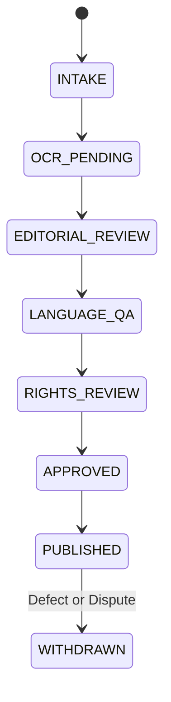

# NIHOMI.COM — MASTER ENGINE CONTRACTS & INTERFACE SPECIFICATIONS
**Document ID:** `NIHOMI-ENG-2026-V1`  
**Governance Authority:** Nihomi Core Systems Architecture  
**Effective Date:** 17 October 2026  
**Status:** BINDING PRODUCTION SPECIFICATION  

---

## Engine 1: Kana Studio & Vector Writing Canvas

### 1.1 Purpose & Scope
Provides an accessible, tactile 2D canvas for handwritten Japanese character evaluation, validating stroke order, direction, starting coordinates, and stroke count.

### 1.2 TypeScript Contract & Data Models
```typescript
export interface StrokePoint {
  x: number; // Normalized coordinate [0, 100]
  y: number; // Normalized coordinate [0, 100]
  t: number; // Timestamp in milliseconds
}

export type DrawnStroke = StrokePoint[];

export interface StrokeEvaluationResult {
  isValid: boolean;
  score: number; // 0 to 100
  errorType?: 
    | 'wrong_stroke_count'
    | 'incomplete_stroke'
    | 'extra_stroke'
    | 'wrong_direction'
    | 'wrong_start_position'
    | 'zero_length_stroke'
    | 'empty_drawing'
    | 'unsupported_template';
  strokeIndex?: number;
  feedbackBengali: string;
}

export interface KanaEngineContract {
  hasKanaStrokeTemplate(char: string): boolean;
  evaluateStrokeSequence(char: string, drawnStrokes: DrawnStroke[]): StrokeEvaluationResult;
}
```

### 1.3 Invariants & Operational Rules
1. **Direction Tolerance:** The angle between vector start-to-end and canonical path must not exceed $45^\circ$.
2. **Start Coordinate Tolerance:** The Euclidean distance between drawn origin and canonical origin must not exceed $38\%$ of canvas width.
3. **Unsupported Glyphs:** If a character lacks a verified vector path template, the engine MUST return `'unsupported_template'` with honest guidance: *"এই অক্ষরের যাচাই এখনো প্রস্তুত নয়। নির্দেশিকা দেখে মুক্তহস্তে অনুশীলন করুন।"* It must never pretend to pass or fail randomly.

---

## Engine 2: JLPT Mock Exam Engine (N5–N1)

### 2.1 Purpose & Scope
Simulates official JLPT examination conditions, covering Vocabulary/Kanji (*Moji-Goi*), Grammar (*Bunpou*), Reading Comprehension (*Dokkai*), and Listening (*Choukai*).

### 2.2 TypeScript Contract & Data Models
```typescript
export type JlptLevel = 'N5' | 'N4' | 'N3' | 'N2' | 'N1';

export interface JlptQuestion {
  id: string;
  level: JlptLevel;
  section: 'vocabulary' | 'grammar' | 'reading' | 'listening';
  questionJapanese: string;
  furigana?: string;
  options: [string, string, string, string];
  correctOptionIndex: 0 | 1 | 2 | 3;
  explanationBengali: string;
  sourcePdfId: string;
  rightsStatus: 'approved' | 'editorial_staging' | 'unverified';
}

export interface ExamSessionState {
  sessionId: string;
  level: JlptLevel;
  startTime: number;
  timeRemainingSeconds: number;
  answers: Record<string, number>; // questionId -> selectedOptionIndex
  isCompleted: boolean;
  score?: {
    totalQuestions: number;
    correctCount: number;
    percentage: number;
    passed: boolean;
  };
}
```

### 2.3 Invariants & Operational Rules
1. **Level Filtering:** Mock exam selection must strictly filter questions matching the requested level.
2. **N2/N1 Staging Notice:** When N2 or N1 tests are loaded, the UI must render an explicit amber disclaimer: *"JLPT N2/N1 প্রশ্নব্যাংক বর্তমানে এডিটরিয়াল স্টেজিংয়ে রয়েছে (OCR প্রুফরিডিং চলছে)"*.
3. **No Unlicensed "Official" Claims:** The engine must be titled "Authentic JLPT-Style Practice Mock Simulator". It must never claim trademark authorization from the Japan Foundation.

---

## Engine 3: WorkOS™ Tokyo Immersion Engine

### 3.1 Purpose & Scope
Simulates Tokyo workplace and daily relocation scenarios (*Konbini*, restaurants, airports, city halls, and interviews), reinforcing contextual keigo and consequence-driven decision making.

### 3.2 TypeScript Contract & Data Models
```typescript
export interface DialogueOption {
  id: string;
  textJapanese: string;
  romaji: string;
  explanationBengali: string;
  politenessLevel: 'casual' | 'polite_desu_masu' | 'formal_keigo';
  isCorrect: boolean;
  customerReactionJapanese: string;
  customerReactionBengali: string;
  consequenceFeedbackBengali: string;
}

export interface ScenarioNode {
  id: string;
  title: string;
  setting: string;
  customerRole: string;
  contextBengali: string;
  audioPromptUrl?: string;
  options: DialogueOption[];
}
```

### 3.3 Invariants & Operational Rules
1. **Consequence Branching:** Selecting informal speech when serving a customer must produce realistic customer confusion, accompanied by a polite explanation in Bengali from Nomi Sensei.
2. **Retry Protocol:** Learners are given 1 immediate retry opportunity with hints before a full scenario reset.

---

## Engine 4: Nomi Sensei Universal Companion Engine

### 4.1 Purpose & Scope
Provides warm, conversational, curriculum-safe tutoring in natural Bengali, offering micro-explanations for errors, hints, and encouragement.

### 4.2 TypeScript Contract & Data Models
```typescript
export interface SenseiDialogueRequest {
  studentId: string;
  currentRoute: string;
  activeLessonId?: string;
  lastMistakeContext?: {
    questionId: string;
    studentAnswer: string;
    expectedAnswer: string;
  };
  promptText: string;
}

export interface SenseiDialogueResponse {
  replyBengali: string;
  japaneseSampleSnippet?: string;
  suggestedAction?: 'retry' | 'review_kana' | 'continue_lesson';
  curriculumSafetyPassed: boolean;
}
```

### 4.3 Invariants & Operational Rules
1. **Curriculum Prerequisite Gate:** Any Japanese character or grammar snippet included in Nomi Sensei's output must be verified against the student's unlocked curriculum graph. Untaught kanji are strictly barred.
2. **Zero Shaming:** Tone must remain warm, patient, and uplifting. Zero condescending phrasing.

---

## Engine 5: Content Pipeline & Publishing Engine

### 5.1 Purpose & Scope
Controls the intake, OCR processing, pedagogical QA, rights verification, and publication of educational materials.

### 5.2 Content Lifecycle State Machine


### 5.3 Invariants & Operational Rules
1. **No Raw OCR to Learners:** Content with `OCR_PENDING` or `EDITORIAL_REVIEW` status is strictly barred from student-facing production views.
2. **Provenance Preservation:** Every published question must retain its source document ID and page reference.

---

## Engine 6: MemoryOS & Progress Persistence Engine

### 6.1 Purpose & Scope
Manages student mastery tracking, active recall schedules, and transparent state synchronization between local browser storage and durable cloud storage.

### 6.2 TypeScript Contract & Data Models
```typescript
export interface MasteryNodeState {
  nodeId: string;
  status: 'locked' | 'unlocked' | 'practicing' | 'mastered';
  correctStreak: number;
  totalAttempts: number;
  lastAttemptTimestamp: number;
  nextReviewTimestamp: number;
  storageState: 'local_unverified' | 'cloud_persisted';
}

export interface MemoryOsSyncContract {
  recordAttempt(nodeId: string, isCorrect: boolean): Promise<MasteryNodeState>;
  syncLocalToCloud(): Promise<{ syncedCount: number; failedCount: number }>;
}
```

### 6.3 Invariants & Operational Rules
1. **Honest Labeling:** The UI must display `local_unverified` when offline, and only transition to `cloud_persisted` after the server returns HTTP 200 OK.
2. **Idempotent Writes:** Network retries must not duplicate attempt counts or skew streak calculations.

---

## Engine 7: Progressive Web App (PWA) & Offline Engine

### 7.1 Purpose & Scope
Enables reliable, installable offline operation for mobile and desktop learners across Bangladesh.

### 7.2 Invariants & Operational Rules
1. **Strict Cache Boundary:** `public/sw.js` must NEVER cache `/api/*`, `/auth/*`, or `/billing/*` responses.
2. **Offline Mode:** When offline, static assets and previously cached workbooks remain accessible, accompanied by an amber banner informing the student that progress is queued locally.

---

## Engine 8: Identity & Authorization Engine (RBAC)

### 8.1 Role Definitions
- **`guest`:** Unauthenticated visitor. Access to Landing, Demo Stage 1, Pricing, and Public Docs.
- **`student`:** Authenticated learner. Access to Lessons, Quizzes, Kana Canvas, WorkOS, and Profile.
- **`sensei`:** Teacher / Content Reviewer. Access to student progress summaries and grading portals.
- **`founder`:** Platform Owner. Full operational visibility, revenue metrics, and system health checks.
- **`admin`:** System Administrator. Database maintenance and technical telemetry.

### 8.2 Invariants & Operational Rules
1. **Server-Side Authorization:** Admin and Founder routes MUST be guarded server-side via JWT claims, never relying on UI element hiding alone.
2. **Zero Role Leakage:** 403 Forbidden responses must not reveal existence or schema of internal endpoints.

---

## Engine 9: Billing & Monetization Gateway Engine

### 9.1 Purpose & Scope
Enforces the canonical 12-price matrix and handles tokenized checkout flows with automated, idempotent entitlement granting.

### 9.2 Invariants & Operational Rules
1. **Single Source of Truth:** Prices are verified on the server against `server/services/canonicalPricing.ts`. Client-sent amounts are ignored.
2. **Webhook Idempotency:** Payment callbacks verify HMAC signatures and check transaction uniqueness in the `payments` table before granting subscriptions.
