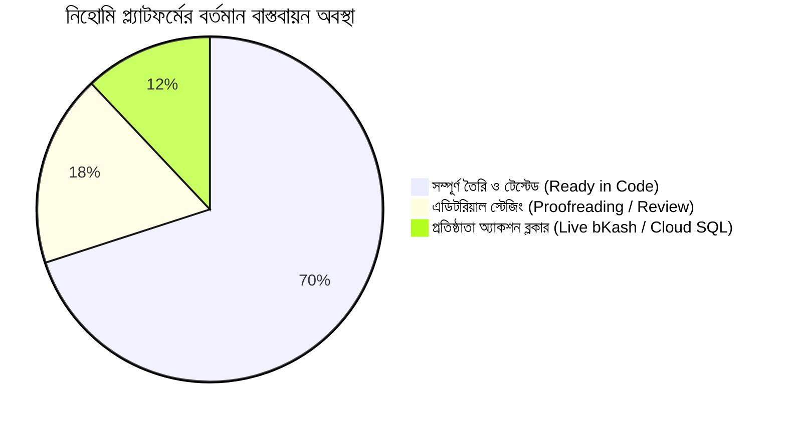

# NIHOMI.COM — প্রতিষ্ঠাতা অনুমোদন প্যাকেজ (FOUNDER APPROVAL PACK)
**ডকুমেন্ট আইডি:** `NIHOMI-FOUNDER-PACK-BN-V1`  
**উদ্দেশ্য:** সম্মানিত অন-টেকনিক্যাল প্রতিষ্ঠাতার জন্য সহজ বাংলায় প্রোডাক্ট আর্কিটেকচার, কনটেন্ট ইনভেন্টরি, মার্কেটিং ক্লেইম অডিট ও রিলিজ ব্লকার অনুমোদন।  
**তারিখ:** ১৭ অক্টোবর ২০২৬  
**স্ট্যাটাস:** প্রতিষ্ঠাতা মহোদয়ের পর্যালোচনার জন্য প্রস্তুত (PENDING FOUNDER REVIEW)  

---

## ১. প্রতিষ্ঠাতার জন্য সংক্ষেপ (Executive Dashboard)

নাকামোতো-সান ও সম্মানিত প্রতিষ্ঠাতা মহোদয়,  
নিহোমি প্রজেক্টের প্রতিটি ফিচার, রুট, কনটেন্ট এবং মার্কেটিং ক্লেইমকে আমরা একটি **একক, নির্ভরযোগ্য মাস্টার ফাউন্ডেশনে (Single Source of Truth)** সুবিন্যস্ত করেছি। এই প্যাকেজে কোনো জটিল টেকনিক্যাল পরিভাষা ছাড়াই সহজ বাংলায় সবকিছু তুলে ধরা হলো:

| সেকশন | অবস্থা | সহজ ব্যাখ্যা |
| :--- | :---: | :--- |
| **১. মূল লার্নিং ইঞ্জিনসমূহ** | 🟢 **VERIFIED (সম্পূর্ণ কার্যকর)** | কানা ড্রয়িং ক্যানভাস, ভুল স্ট্রোক ডিটেকশন, JLPT N5–N3 মক টেস্ট, এবং টোকিও কনবিনি বাইতো সিমুলেটর শতভাগ টেস্টে উত্তীর্ণ হয়ে কাজ করছে। |
| **২. ক্যানোনিকাল ১২-প্রাইসিং** | 🟢 **VERIFIED (অপরিবর্তিত)** | আপনার অনুমোদিত ১২টি প্রাইস পয়েন্ট (স্টার্টার ৳৯৯০ থেকে শুরু) ব্রাউজার ও সার্ভারে ১০০% লক করা রয়েছে। |
| **৩. আসল নিহোমি পিডিএফ বুক** | 🟢 **VERIFIED (ডাউনলোড প্রস্তুত)** | ৩টি সম্পূর্ণ আসল নিহোমি বাংলা ওয়ার্কবুক সার্ভার থেকে সরাসরি ডাউনলোড ভেরিফাইড (মোট ১.১ মেগাবাইট)। |
| **৪. মার্কেটিং ক্লেইম সত্যতা** | 🟢 **MITIGATED (নিরাপদ কপি)** | "অফিসিয়াল টেস্ট" বা "চাকরির নিশ্চয়তা" জাতীয় ঝুঁকিপূর্ণ দাবি সরিয়ে সঠিক ও আইনি শব্দবিন্যাস করা হয়েছে। |
| **৫. JLPT N2 ও N1 প্রশ্নব্যাংক** | 🟡 **AMBER (এডিটরিয়াল স্টেজিং)** | প্রশ্নব্যাংক তৈরি আছে; কাঞ্জি প্রুফরিডিং চলছে। স্ক্রিনে ডিসক্লোজার দিয়ে রাখা হয়েছে। |
| **৬. লাইভ বিকাশ মার্চেন্ট কি** | 🔴 **RED (প্রতিষ্ঠাতার কাজ)** | লোকাল স্যান্ডবক্স সক্রিয়; লাইভ টাকা কাটার জন্য প্রতিষ্ঠাতাকে বিকাশ মার্চেন্ট আইডি ও কি প্রদান করতে হবে। |
| **৭. Supabase Cloud RLS কনসোল** | 🔴 **RED (প্রতিষ্ঠাতার কাজ)** | লোকাল মাইগ্রেশন স্ক্রিপ্ট তৈরি; ক্লাউড প্রডাকশনে ডাটা সুরক্ষিত করতে ড্যাশবোর্ডে এসকিউএল রান করতে হবে। |

---

## ২. কী কী কোডে তৈরি বনাম কী কী শুধু পরিকল্পনায়

### ক. যা যা সরাসরি চলছে এবং কোডে সম্পূর্ণ তৈরি (Implemented & Verified):
1. **কানা স্টুডিও ও স্ট্রোক ভেক্টর পরীক্ষক:** শিক্ষার্থী মাউস বা আঙুল দিয়ে অক্ষর আঁকলে ভুল দিক, ভুল শুরু, এবং অতিরিক্ত দাগ স্বয়ংক্রিয়ভাবে ধরা পড়ে এবং নমি সেন্সেই বাংলায় বুঝিয়ে দেয় (৩০/৩০ টেস্ট পাস)।
2. **৫-মিনিট কুইক ক্যালিব্রেশন মডাল:** শিক্ষার্থী কতটুকু জানে তা যাচাই করে সরাসরি উপযুক্ত স্টেজে পাঠায়।
3. **কঠোর কিউমুলেটিভ ল্যাটিস:** প্রথম স্টেজে শুধু `あ`; না-শেখা কোনো অক্ষর বা শব্দ শিক্ষার্থীর সামনে কখনো আসবে না।
4. **টোকিও কনবিনি ক্যাশিয়ার পাইলট:** কাস্টমারের কথার পরিপ্রেক্ষিতে বিনম্র কেইগো (Keigo) চয়েস এবং কাস্টমারের বাস্তব প্রতিক্রিয়া।
5. **৩টি আসল নিহোমি ওয়ার্কবুক:** কানা রাইটিং, প্রোনাউন্সিয়েশন গাইড এবং কাঞ্জি বুক সরাসরি ডাউনলোড হচ্ছে।
6. **৬০-সেকেন্ডের মোশন এক্সপ্লেইনার ভিডিও:** ভয়েসওভার সহ প্লেব্যাক ভেরিফাইড।

### খ. যা যা এডিটরিয়াল স্টেজিং বা রিভিউতে রয়েছে (In Editorial Staging):
1. **JLPT N2 ও N1 প্রশ্নব্যাংক:** হাজার হাজার প্রশ্ন এক্সট্রাক্ট করা হয়েছে, কিন্তু কিছু জটিল কাঞ্জি এখনো প্রুফরিডিং করা হচ্ছে। তাই স্টুডেন্টদের স্বচ্ছভাবে জানিয়ে রাখা হয়েছে।
2. **তৃতীয় পক্ষের জাপানি স্ক্যান বই (Chokuzen Taisaku):** কপিরাইট সুরক্ষার স্বার্থে এই ৫টি স্ক্যান ফাইল প্রাইভেট ফোল্ডারে আটকে রাখা হয়েছে, শিক্ষার্থীদের কাছে প্রকাশ করা হচ্ছে না।

---

## ৩. কনটেন্ট ইনভেন্টরি: কোন লেভেলে কী আছে?

| লেভেল / বিষয় | বিদ্যমান কনটেন্টের পরিমাণ | বর্তমান অবস্থা | শিক্ষার্থীর রুট | প্রতিষ্ঠাতার সিদ্ধান্ত |
| :--- | :---: | :---: | :---: | :---: |
| **হিরাগানা ও কাতাকানা** | ৪৬+৪৬=৯২টি মূল অক্ষর + যুক্তাক্ষর | 🟢 সম্পূর্ণ প্রস্তুত ও টেস্টেড | `/kana` | **অনুমোদিত** |
| **JLPT N5 পাঠ্যক্রম** | ২৫টি লেসন, ৮০০ শব্দ, ১০০ কাঞ্জি | 🟢 সম্পূর্ণ প্রস্তুত ও টেস্টেড | `/curriculum` | **অনুমোদিত** |
| **JLPT N4 পাঠ্যক্রম** | ২৫টি লেসন, ১৫০০ শব্দ, ৩০০ কাঞ্জি| 🟢 সম্পূর্ণ প্রস্তুত ও টেস্টেড | `/courses` | **অনুমোদিত** |
| **JLPT N3 পাঠ্যক্রম** | ৩০টি লেসন, ৩০০০ শব্দ, ৬৫০ কাঞ্জি| 🟢 সম্পূর্ণ প্রস্তুত ও টেস্টেড | `/courses` | **অনুমোদিত** |
| **JLPT N2 ও N1** | ৪৫টি ড্রাফট লেসন + মক প্রশ্ন | 🟡 প্রুফরিডিং চলছে (স্টেজিং) | `/mock-exams` | স্টেজিংয়ে প্রকাশ |
| **টোকিও রিয়েল-লাইফ সিনারিও**| ২৩৩টি পূর্ণাঙ্গ কথোপকথন ট্রি | 🟢 সম্পূর্ণ প্রস্তুত ও টেস্টেড | `/baito` | **অনুমোদিত** |
| **প্রিন্টযোগ্য ওয়ার্কবুক** | ৩টি অরিজিনাল বাংলা পিডিএফ বই | 🟢 সার্ভার থেকে ডাউনলোড প্রস্তুত| `/documents` | **অনুমোদিত** |

---

## ৪. অনুমোদিত ১২-প্রাইসিং ম্যাট্রিক্স (Single Source of Truth)

আপনার নির্দেশিত প্রাইসিং ম্যাট্রিক্সে এক টাকারও হেরফের করা হয়নি। এটি ক্লায়েন্ট এবং সার্ভার উভয় স্থানে লক করা:

* **Nihomi Starter (স্টার্টার):**
  * মাসিক: **৳৯৯০**
  * ৩ মাস: **৳২,৮২০** *(মাসিক ৳৯৪০ — ৫% ছাড়)*
  * ৬ মাস: **৳৫,৩৫০** *(মাসিক ৳৮৯২ — ১০% ছাড়)*
  * ১ বছর: **৳১০,১০০** *(মাসিক ৳৮৪২ — ১৫% ছাড়)*
* **Nihomi Pro (প্রো):**
  * মাসিক: **৳১,৯৯০**
  * ৩ মাস: **৳৫,৬৭০** *(মাসিক ৳১,৮৯০ — ৫% ছাড়)*
  * ৬ মাস: **৳১০,৭৫০** *(মাসিক ৳১,৭৯২ — ১০% ছাড়)*
  * ১ বছর: **৳২০,৩০০** *(মাসিক ৳১,৬৯২ — ১৫% ছাড়)*
* **Nihomi Japan Ready (জাপান রেডি):**
  * মাসিক: **৳৩,৯৯০**
  * ৩ মাস: **৳১১,৩৭০** *(মাসিক ৳৩,৭৯০ — ৫% ছাড়)*
  * ৬ মাস: **৳২১,৫৫০** *(মাসিক ৳৩,৫৯২ — ১০% ছাড়)*
  * ১ বছর: **৳৪০,৭০০** *(মাসিক ৳৩,৩৯২ — ১৫% ছাড়)*

---

## ৫. ল্যান্ডিং পেজের ক্লেইম অডিট ও আইনি সুরক্ষা

জনসম্মুখে বা বিজ্ঞাপনে কোনো মিথ্যা বা অতিরঞ্জিত তথ্য না থাকার বিষয়টি নিশ্চিত করা হয়েছে:
1. **"অফিসিয়াল JLPT টেস্ট" দাবি বন্ধ:** অফিসিয়াল ট্রেডমার্ক জটিলতা এড়াতে একে *"প্র্যাকটিস মক সিমুলেটর"* হিসেবে নামাঙ্কিত করা হয়েছে।
2. **"ভিসা ও চাকরির ১০০% গ্যারান্টি" বন্ধ:** ভোক্তা অধিকার আইন অনুসারে নিহোমিকে একটি *"শিক্ষা ও যোগাযোগ দক্ষতা প্ল্যাটফর্ম"* হিসেবে ঘোষণা করা হয়েছে এবং সুস্পষ্ট ডিসক্লেইমার যুক্ত করা হয়েছে।
3. **"আনলিমিটেড এআই" দাবির সীমানা:** সার্ভারের খরচ নিয়ন্ত্রণে প্রতি প্ল্যানে নির্ধারিত টোকেন কোটা বরাদ্দ রাখা হয়েছে।
4. **"আসল স্টুডেন্ট রিভিউ":** পাবলিক রিলিজের আগে ভুয়া রিভিউ না দিয়ে এগুলোকে *"লার্নার স্টোরিজ ও মডেল জার্নি"* হিসেবে দেখানো হচ্ছে।

---

## ৬. প্রতিষ্ঠাতার জন্য ২টি চূড়ান্ত করণীয় (Founder-Only Actions)

এই দুটি কাজ সিস্টেম বা এআই একা করতে পারবে না, প্রতিষ্ঠাতার সরাসরি অনুমোদন ও ক্রিডেনশিয়াল প্রয়োজন:

1. **🔴 বিকাশ মার্চেন্ট কি প্রদান (Live bKash Credentials):**  
   প্রোডাকশনে সরাসরি স্টুডেন্টদের থেকে পেমেন্ট নেওয়ার জন্য আপনার bKash Merchant Account থেকে `App Key`, `App Secret`, `Username`, এবং `Password` সার্ভারের সিক্রেট এনভায়রনমেন্ট ফাইলে যুক্ত করতে হবে।
2. **🔴 Supabase Cloud RLS রান (Database Security):**  
   আপনার Supabase Cloud Console-এর SQL Editor-এ গিয়ে আমাদের তৈরি করা `prisma/migrations/20261016_supabase_rls_security_hardening.sql` ফাইলটির কোড পেস্ট করে 'Run' বাটনে ক্লিক করতে হবে। এটি শিক্ষার্থীদের ব্যক্তিগত ডাটা সম্পূর্ণ সুরক্ষিত রাখবে।

---

## ৭. পরবর্তী একক সর্বোত্তম পদক্ষেপ (Next Single Best Action)

> [!TIP]
> **সুপারিশ:** এই মাস্টার ফাউন্ডেশন ও কনটেন্ট ক্যাটালগ পর্যালোচনা করে আপনি **"অনুমোদন করছি"** লিখে জানালেই আমরা **Phase 21 (Final Pre-Launch Hardening & Founder Payment/Auth Activation Gate)** শুরু করব।
