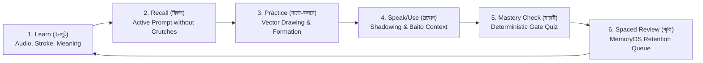
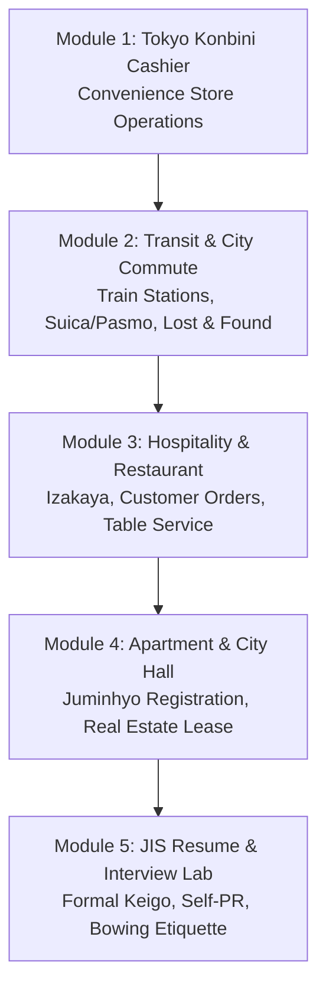

# NIHOMI.COM — LEARNING JOURNEY CONSTITUTION & PEDAGOGICAL PROGRESSION
**Document ID:** `NIHOMI-JOURNEY-2026-V1`  
**Governance Authority:** Learning Experience Architect & Japanese Curriculum Specialist  
**Effective Date:** 17 October 2026  
**Status:** REUSABLE CANONICAL LEARNING FRAMEWORK  

---

## 1. The Core Pedagogical Architecture

### 1.1 The Golden Learning Loop
Every learning module in Nihomi follows a continuous 6-phase cycle designed to build durable neuromuscular memory and conversational reflex:

1. **Phase 1: Learn (জ্ঞানার্জন — Input):** High-definition native Japanese audio pronunciation paired with a clear 1-sentence Bengali explanation and animated vector stroke breakdown.
2. **Phase 2: Recall (সক্রিয় স্মরণ — Active Recall):** The learner is prompted to identify the character or word from auditory cues without seeing the English romanization (romaji crutches removed).
3. **Phase 3: Practice (হাতে-কলমে অনুশীলন — Tactile Writing):** The learner traces and draws the glyph on the interactive 2D canvas, satisfying stroke order, start coordinates, and direction constraints.
4. **Phase 4: Speak & Use (বাস্তব প্রয়োগ — Contextual Immersion):** The item is immediately placed inside a Tokyo workplace sentence or everyday micro-dialogue.
5. **Phase 5: Mastery Check (মূল্যায়ন — Verification Gate):** An unassisted 3-question evaluation. Clicks or skipped screens do not count. Correct answers unlock the next node in the graph.
6. **Phase 6: Spaced Review (দীর্ঘমেয়াদী স্মৃতি — SRS):** The item is entered into the `MemoryOS` schedule at 1-day, 3-day, 7-day, 14-day, and 30-day intervals.

---

## 2. Onboarding & Quick Calibration Protocol

### 2.1 The 5 Diagnostic Tracks
When a new or returning student visits Nihomi, they enter the 5-minute **Bengali Quick Calibration Engine** (`src/core/curriculum/quickCalibrationEngine.ts`):

| Track ID | Stated Background | Diagnostic Test Required | Starting Node Placement |
| :---: | :--- | :--- | :--- |
| **Track A** | **Zero Japanese (একদম নতুন)** | Zero tests needed. Instant routing. | **Stage 1 (`あ`)** in Hiragana Foundations |
| **Track B** | **Some Hiragana (হিরাগানা কিছুটা চিনি)** | 3-item Kana recognition test | If passed: Stage 6 (Ka-line) or intermediate kana; Else: Stage 1 |
| **Track C** | **Dual Kana Master (হিরাগানা ও কাতাকানা জানি)**| 5-item dual-kana & word formation test | Stage 11 (Katakana Lab) or JLPT N5 Stage 1 |
| **Track D** | **JLPT N5/N4 Aspirant (পরীক্ষার প্রস্তুতি)** | 5-item grammar & kanji diagnostic | Placed at verified JLPT N5 unit or N4 starter unit |
| **Track E** | **Returning Learner (আগে শিখেছি, ভুলে গেছি)**| Comprehensive 10-item diagnostic | Custom gap repair queue targeting forgotten nodes |

### 2.2 Law of Honest Starting Point
> [!IMPORTANT]
> **Anti-Illusion Law:**  
> A user's self-selected preference or perceived skill level serves **strictly as an initial diagnostic recommendation**, never as granted mastery.  
> Unearned mastery badges or certificates are strictly prohibited. Mastery status requires passing deterministic assessment verification.

---

## 3. Detailed Learner Progression Pathways

### Pathway 1: Absolute Beginner (Zero to Dual Kana)
- **Phase 1.1: 5 Pure Vowels (`あ`, `い`, `う`, `え`, `お`):**
  - Stage 1: `あ` (Zero compound words permitted).
  - Stage 2: `い` $\rightarrow$ Unlocks first word `あい` (*Ai*).
  - Stage 3: `う` $\rightarrow$ Unlocks `いう` (*Iu*), `あう` (*Au*).
  - Stage 4: `え` $\rightarrow$ Unlocks `いえ` (*Ie*), `うえ` (*Ue*), `え` (*E*).
  - Stage 5: `お` $\rightarrow$ Unlocks `あお` (*Ao*), `おおい` (*Ooi*).
  - Milestone Review Gate: 5-Vowel synthesis quiz.
- **Phase 1.2: Consonant Lines (Ka through Wa lines):**
  - Ka, Sa, Ta, Na, Ha, Ma, Ya, Ra, Wa lines introduced strictly one by one.
- **Phase 1.3: Sound Modifiers:**
  - Dakuten (`が`, `ざ`, `だ`, `ば`) and Handakuten (`ぱ`).
  - Yoon (contracted sounds: `きゃ`, `しゅ`, `ちょ`).
  - Sokuon (small `っ` double consonants) and Chōon (long vowels).
- **Phase 1.4: Katakana & Foreign Loanwords:**
  - Full Katakana parallel lattice for loanwords (`コーヒー`, `コンビニ`, `バス`).

### Pathway 2: JLPT N5 — Everyday Communication & Core Foundations
- **Vocabulary:** 800 core foundational words (Food, family, time, money, directions).
- **Grammar Units (Aligned with Minna no Nihongo Lessons 1–25):**
  - Particles: `は`, `が`, `を`, `に`, `へ`, `で`, `と`, `も`, `から`, `まで`.
  - Verbs: Group 1, Group 2, Group 3 conjugation; Te-form (`〜てください`), Masu-form, Dictionary form, Nai-form.
  - Adjectives: I-adjectives vs Na-adjectives, past and negative forms.
- **Kanji Foundations:** The 100 essential N5 Kanji (Numbers, nature, directions, people, time).

### Pathway 3: JLPT N4 — Intermediate Structure & Complex Sentences
- **Grammar Units (Aligned with Minna no Nihongo Lessons 26–50):**
  - Potential form (`〜られる`), Volitional form (`〜よう`), Imperative/Prohibitive, Conditional forms (`〜たら`, `〜ば`, `〜なら`).
  - Passive (`〜れる`) and Causative (`〜させる`) constructions.
  - Basic Honorifics & Humble Japanese (*Sonkeigo* and *Kenjōgo* foundations).
- **Vocabulary & Kanji:** 1,500 words, 300 essential Kanji.

### Pathway 4: JLPT N3 — The Bridge to Professional Fluency
- **Grammar & Nuance:** Nuanced particles (`〜わけだ`, `〜はずだ`, `〜に対して`, `〜において`).
- **Workplace Communication:** Reading emails, understanding notices, job announcements, and formal telephone Japanese.
- **Vocabulary & Kanji:** 3,000 words, 650 Kanji.

### Pathway 5: JLPT N2 & N1 (Advanced Roadmap)
- Currently maintained under **Editorial Staging & Verification**.
- Curriculum content undergoing multi-pass OCR proofreading and bilingual review before public release.
- Fully transparent disclosure to students that N2/N1 banks are in preview testing.

---

## 4. WorkOS™: Tokyo Workplace Immersion Journey

For students aiming for relocation, SSW, or study abroad, language is immediately paired with cultural and operational survival:

- **Interactive branching:** Students make real-time decisions under timer constraints.
- **Politeness scoring:** Feedback explains the sociological difference between casual Japanese, standard polite Japanese (*Desu/Masu*), and formal customer service keigo (*Irasshaimase, Shōshō omachi kudasai*).
- **Consequence Engine:** Realistic outcomes reinforce learning without punitive shame.

---

## 5. MemoryOS: Spaced Repetition (SRS) Engine

1. **Forgetting Curve Mitigation:** Ebbinghaus forgetting curve mathematical model calculates review intervals based on answer response latency and historical mistakes.
2. **Review Priority:** Items with low confidence scores or recent errors are surfaced at the top of the daily dashboard.
3. **Ghost Mode Accelerator:** High-intensity speed drills for items scheduled for review within the current 24-hour window.
