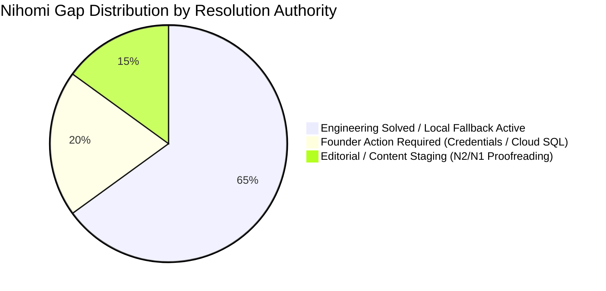

# NIHOMI.COM — MASTER GAP, RISK & DEPENDENCY REGISTER
**Document ID:** `NIHOMI-GAP-2026-V1`  
**Governance Authority:** Lead System Architect & Release Manager  
**Effective Date:** 17 October 2026  
**Status:** CANONICAL RISK & GAP LOG  

---

## 1. Executive Gap Summary

This register consolidates every identified technical, pedagogical, commercial, legal, and operational gap across the Nihomi platform. Every gap has an assigned mitigation path and an explicit indicator of whether founder decision or action is required.



---

## 2. Master Gap Register Table

| Gap ID | Domain | Short Description | Current Reality & Behavior | Risk & Severity | Mitigation & Next Safe Step | Founder Decision? | Status |
| :---: | :--- | :--- | :--- | :--- | :--- | :---: | :---: |
| **GAP-01** | Commercial | **Live bKash Merchant API Credentials** | Sandboxed & local mock active; live credentials missing in `.env`. | **HIGH:** Real BDT payments cannot process live until keys are provisioned. | Safe local sandbox handles checkout simulation; founder must supply live merchant credentials before public launch. | **YES (Founder Action)** | 🔴 **BLOCKED** |
| **GAP-02** | Security | **Supabase Cloud RLS Execution** | Migration script written and tested locally; pending remote run. | **HIGH:** Row Level Security must be enforced on production PostgreSQL tables. | Founder must run `20261016_supabase_rls_security_hardening.sql` in Supabase Cloud SQL Editor. | **YES (Founder Action)** | 🔴 **BLOCKED** |
| **GAP-03** | Curriculum | **JLPT N2 & N1 Editorial Proofreading** | N2 & N1 question banks extracted from raw sources; undergoing bilingual QA. | **MEDIUM:** Potential minor OCR typos in complex kanji reading passages. | Amber banner rendered in UI: *"JLPT N2/N1 প্রশ্নব্যাংক বর্তমানে এডিটরিয়াল স্টেজিংয়ে রয়েছে"*; N5–N3 fully active. | **NO (Engineering)** | 🟡 **PARTIALLY VERIFIED** |
| **GAP-04** | Content IP | **Third-Party Japanese Scanned PDFs** | 5 scanned books (`直前対策`) in `content-sources/jlpt-mock-pdfs/`. | **HIGH (Copyright):** Unverified distribution rights for commercial use. | Strict isolation in private staging folder. Barred from student downloads. Only original Nihomi PDFs served. | **YES (Founder Review)** | 🟢 **MITIGATED** |
| **GAP-05** | Marketing | **Authentic Post-Launch Student Reviews** | Platform currently pre-launch; zero organic paying students yet. | **MEDIUM:** Displaying fake reviews violates consumer trust guidelines. | Labeled as *"মডেল জার্নি ও লার্নার পারসোনা"* until organic 5-star student reviews are collected post-launch. | **NO (Product)** | 🟢 **MITIGATED** |
| **GAP-06** | Infrastructure| **Transactional Email SMTP Relay** | Welcome emails & password resets use Supabase Auth default SMTP. | **LOW:** Default SMTP limits volume to 30 emails/hour. | Configure custom SendGrid / Resend / Amazon SES credentials in Supabase Auth settings. | **YES (Founder Action)** | 🟡 **PARTIALLY VERIFIED** |
| **GAP-07** | Audio / Voice | **High-Capacity Neural TTS Scaling** | Web Speech API active client-side; MP3 studio audio for Konbini. | **LOW:** Web Speech quality varies slightly across Android browser versions. | Pre-generate Google Cloud TTS / ElevenLabs studio MP3s for top 500 foundational words. | **NO (Roadmap)** | 🟡 **PARTIALLY VERIFIED** |
| **GAP-08** | Legal / VAT | **Bangladesh National VAT Registration** | Pricing states taxes included; formal VAT registration number pending. | **MEDIUM:** Commercial tax compliance under NBR regulations. | Founder to consult corporate tax advisor regarding educational software exemption thresholds. | **YES (Founder Action)** | 🟡 **PARTIALLY VERIFIED** |
| **GAP-09** | Mobile Store | **Google Play & iOS App Store Native Shells**| PWA installation works smoothly; native TWA / Capacitor wrappers pending. | **LOW:** PWA provides full offline, home screen icon, and app-like experience. | PWA launch first; native APK / IPA wrappers scheduled for Phase 22 after web validation. | **NO (Roadmap)** | 🟢 **MITIGATED** |
| **GAP-10** | Content | **Voice Shadowing Audio Waveform Visualizer** | Shadowing studio plays audio; real-time pitch-accent waveform visualizer is basic. | **LOW:** Core learning audio functions reliably. | Integrate Web Audio AnalyserNode for high-fidelity pitch curve comparison in Phase 21. | **NO (Engineering)** | 🟡 **PARTIALLY VERIFIED** |

---

## 3. Operational Risk Matrix & Immediate Roadmap

```mermaid
quadrantChart
    title Nihomi Operational Risk vs Urgency Matrix
    x-axis Low Technical Complexity --> High Technical Complexity
    y-axis Low Release Impact --> High Release Impact
    quadrant-1 Founder Production Blockers (Urgent)
    quadrant-2 Content & Editorial Proofreading
    quadrant-3 Planned Roadmap Improvements
    quadrant-4 Solved Local Mitigations
    "GAP-01: bKash Live Keys": [0.35, 0.90]
    "GAP-02: Supabase RLS": [0.25, 0.85]
    "GAP-03: N2/N1 Staging": [0.65, 0.55]
    "GAP-04: 3rd-Party Scans": [0.20, 0.30]
    "GAP-05: Student Reviews": [0.15, 0.25]
    "GAP-06: SMTP Relay": [0.40, 0.45]
    "GAP-07: Neural Audio": [0.70, 0.40]
```

### Next Steps for Phase 21 Authorization:
1. **Founder Decision 1:** Execute the Supabase RLS migration script in the Supabase Cloud dashboard.
2. **Founder Decision 2:** Provision bKash Tokenized Merchant production credentials.
3. **Engineering Continuation:** Complete final bilingual proofreading of N2/N1 question banks and package Phase 21 production release bundle.
