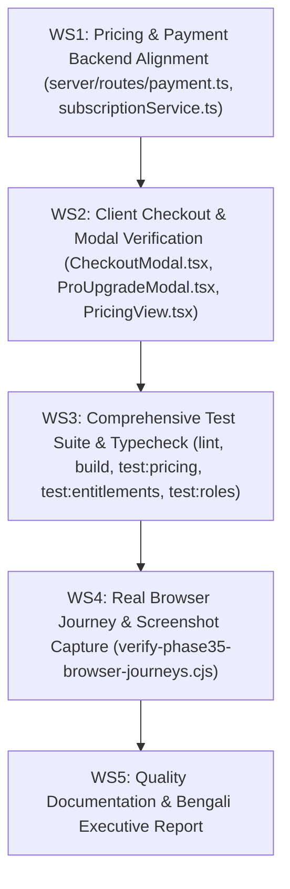

# NIHOMI.COM — MASTER EXECUTION PLAN: PHASE 35
## ONBOARDING, SUBSCRIPTION & PAYMENT READINESS
*Status: Approved for Local Execution | Protocol: Antigravity 2.0 Global Master Protocol v1.0*
*Created: 2026-10-18T20:45:00+06:00 | Workspace: www.Nihomi.com/nihomi-app-1*

---

## A. CURRENT VERIFIED STATE AND EVIDENCE
1. **Server & Health:**
   - Server running on `http://127.0.0.1:3000` (task-23389, Node v24.19.0, Production mode).
   - `/api/health` reports status `ok`, database `healthy` (durable persistent store), Gemini AI `operational`.
   - Payment gateway status in local environment is `not_configured` (gracefully handling missing merchant credentials without crashing).
2. **Phase 34 Baseline Re-Verification:**
   - Design Constitution (`docs/brand/NIHOMI_DESIGN_CONSTITUTION.md`) enforced.
   - 60-22-12-6 Palette Rule intact (`#141726`, `#F6F0E6`, `#E45147`, `#6D7C55`).
   - Cookie consent banner dismissable and non-intrusive.
   - Founder Command Center streamlined (3 executive buttons, 6 focused tabs).
   - Student Dashboard displays the canonical 6-step N.I.H.O.M.I. Learning Loop.
   - All Phase 34 test suites passed: 5/5 roles, 66/66 entitlements, 12/12 pricing, 30/30 kana-strokes, 17/17 curriculum lattice, 233/233 scenarios, 9/9 release gates.
3. **Discovered Defects & Inconsistencies:**
   - `server/routes/payment.ts`: `/api/payment/manual/instructions` was returning legacy pricing (`n5_pro` ৳599, `n5_milestone` ৳1,490, `n5_lifetime` ৳4,990) instead of the canonical 12-price matrix (`starter` ৳990, `pro` ৳1,990, `japan_ready` ৳3,990).
   - `server/services/subscriptionService.ts`: `submitManualPayment` was hard-rejecting `selectedPlan` unless it was `'n5_pro'` or `'n5_lifetime'`, blocking users from selecting `'starter'`, `'pro'`, or `'japan_ready'`.
   - `server/routes/payment.ts`: Fallback tier resolution in `/callback` and `/execute` defaulted to legacy `'n5_pro'` and `'n5_lifetime'` based on `amount >= 1400`, which conflicts with the canonical tier architecture.

---

## B. TARGET OUTCOME AND ACCEPTANCE CRITERIA
1. **Canonical Pricing Everywhere:** All payment endpoints (`/plans`, `/create`, `/callback`, `/execute`, `/manual/instructions`, `/manual/submit`), checkout modals, and upgrade views strictly adhere to the 12 canonical prices:
   - Starter: ৳990, ৳2,820, ৳5,350, ৳10,100
   - Pro: ৳1,990, ৳5,670, ৳10,750, ৳20,300
   - Japan Ready: ৳3,990, ৳11,370, ৳21,550, ৳40,700
2. **Complete Learner-to-Subscription Journey:**
   - Free onboarding (Google Login) guarantees access to JLPT N5 Lessons 1-5, Kana Studio, free educational PDFs, and CV Builder without forced paywall.
   - Subscription checkout creates appropriate transaction records with server-side validation.
   - Idempotent callback processing prevents duplicate credits or double charges.
   - Manual bKash/Nagad TrxID submission supports canonical plans (`starter`, `pro`, `japan_ready`).
3. **Security & Role Boundaries:**
   - Server-side verification for founder access (`mdtanvirkabirbiplob@gmail.com`).
   - Non-founder student (`nihomibd@gmail.com`) strictly isolated from `/founder` (instant redirect by Route Guard).
   - Multi-tenant data isolation: Student A cannot inspect or modify Student B.
4. **Browser & Visual Proof:**
   - 16+ verifiable screenshots capturing the complete onboarding, free features, pricing switching, checkout modal, manual submission, and role boundary flows across viewports.

---

## C. WORKSTREAMS & DEPENDENCIES

---

## D. AGENT ROLES & EXACT RESPONSIBILITIES
1. **Lead Orchestrator (Antigravity):** Directs the overall execution, monitors background tasks, and ensures alignment with Product Constitution.
2. **Payments & Entitlement Engineer:** Audits and aligns `server/routes/payment.ts`, `server/services/subscriptionService.ts`, and `server/services/canonicalPricing.ts`.
3. **Frontend UX Engineer:** Verifies modal pricing selectors, billing period toggles, and responsive layouts.
4. **Security & Role Reviewer:** Enforces default-deny access, JWT validation, and multi-user data isolation.
5. **QA & Browser Automation Engineer:** Creates and executes `scripts/verify-phase35-browser-journeys.cjs` to capture visual evidence across viewports.
6. **Documentation & Release Reporter:** Updates canonical masters and authors `NIHOMI_PHASE35_EXECUTIVE_REPORT_BN.md`.

---

## E. FILES, ROUTES & SYSTEMS IN SCOPE
- `server/routes/payment.ts`: Align `/manual/instructions`, `/manual/submit`, `/callback`, and `/execute` with canonical pricing and plans.
- `server/services/subscriptionService.ts`: Support `starter`, `pro`, `japan_ready` in `submitManualPayment` and manual plan resolution.
- `server/services/canonicalPricing.ts`: Reference single source of truth for 12 canonical price combinations.
- `src/components/CheckoutModal.tsx`: Verify 12 canonical prices, interval switching, and error handling.
- `src/components/billing/ProUpgradeModal.tsx`: Verify automated and manual checkout triggers.
- `src/views/PricingView.tsx`: Verify public plan cards and billing period selectors.
- `scripts/verify-phase35-browser-journeys.cjs`: Automated Puppeteer browser test suite.
- `docs/nihomi-master/`: Update release tracker, claim-to-capability matrix, and evidence ledger.

---

## F. RISKS & MITIGATION
| Risk | Severity | Mitigation |
|---|:---:|---|
| **Accidental live charges** | Critical | Gateway in stub/connecting mode in local environment; no live merchant API keys used. |
| **Legacy pricing resurgence** | High | Enforce canonical pricing validator (`validatePurchaseAmount`); run `test:pricing`. |
| **Unauthorized role elevation** | Critical | Server-side role check strictly binds founder privileges to `mdtanvirkabirbiplob@gmail.com`. |
| **Data regression** | Medium | Preserve `founder_office_db.json` and in-memory DB state; zero destructive git commands. |

---

## G. TEST STRATEGY & EVIDENCE ARTIFACTS
1. Typecheck: `npm run lint` (`tsc --noEmit`) -> 0 errors.
2. Production Build: `npm run build` -> clean `dist/server.cjs` and client bundles.
3. Unit & Integration Suites:
   - `npm run test:pricing` (12/12 PASS)
   - `npm run test:entitlements` (66/66 PASS)
   - `npm run test:roles` (5/5 PASS)
   - `npm run test:kana-strokes` (30/30 PASS)
   - `npm run validate:curriculum` (17/17 PASS)
   - `npm run validate:scenarios` (233/233 PASS)
   - `npm run verify:gate` (9/9 PASS)
4. Real Browser Journey Suite:
   - `node scripts/verify-phase35-browser-journeys.cjs` -> capturing evidence in `evidence/phase35/`.

---

## H. ROLLBACK / RECOVERY APPROACH
All code changes are tracked in git feature branch `feature/visual-landing-rebuild-v2`. Any defective modification can be selectively restored via git checkout for specific files without destructive resets.

---

## I. FOUNDER APPROVAL GATES
- Local coding, alignment, and testing proceed autonomously.
- Explicit pause required before:
  - Live production deployment
  - Live payment gateway activation
  - Production database schema mutations

---

## J. DEFINITION OF DONE (DOD)
1. 100% test suites passing.
2. Zero legacy pricing leaks in payment endpoints.
3. Student free features (Lessons 1-5, Kana, PDFs, CV Builder) verified.
4. Browser evidence captured for complete funnel.
5. Bengali Executive Report authored.
