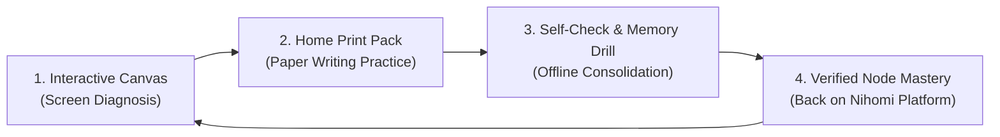

# NIHOMI.COM — PRINT LEARNING SYSTEM & WORKBOOK CONSTITUTION
**Document ID:** `NIHOMI-PRINT-2026-V1`  
**Governance Authority:** Japanese Curriculum Specialist & Print Learning Designer  
**Effective Date:** 17 October 2026  
**Status:** CANONICAL REUSABLE PRINT ARCHITECTURE  

---

## 1. System Vision & The "Screen-to-Paper" Philosophy

Nihomi is designed for **Hybrid Kinesthetic Learning**:
1. **On-Screen Interactive Canvas:** Immediate neuromuscular feedback, stroke direction checking, and error diagnosis via Nomi Sensei.
2. **At-Home Printable Workbooks:** Tangible pen-and-paper muscle memory, tactile stroke consolidation, and distraction-free study.



> [!IMPORTANT]
> **Anti-Passive Rule:**  
> Merely downloading, printing, or tracing a worksheet **does NOT grant mastery** in Nihomi. Mastery is earned exclusively when the student demonstrates recall and stroke competence on the platform's verification gates.

---

## 2. Technical Print Tokens & Layout Standards

All Nihomi printable documents strictly follow international ISO A4 standard geometry:

| Token Name | Specification | Rationale |
| :--- | :--- | :--- |
| **Page Format** | **ISO A4** ($210 \times 297\text{ mm}$ / $595.28 \times 841.89\text{ pt}$) | Universal standard in Bangladesh and Japan. |
| **Safe Margins** | Top: $15\text{ mm}$, Bottom: $15\text{ mm}$, Left: $15\text{ mm}$, Right: $15\text{ mm}$ | Prevents clipping on standard home inkjet/laser printers. |
| **Ink-Conscious Palette** | Deep Ink (`#141726`) on Pure White (`#FFFFFF`) with $15\%$ Gray Grid | Minimizes home printer ink consumption while retaining contrast. |
| **Grayscale Safety** | All lines, arrows, and borders are tested at $100\%$ grayscale | Readable on black-and-white laser printers without loss of meaning. |
| **Header Banner** | $25\text{ mm}$ height with official Nihomi mark + title + JLPT badge | Establishes immediate institutional authority and level clarity. |
| **Discreet Footer** | $12\text{ mm}$ bottom stripe with page number, copyright, and URL | Format: `Nihomi.com (にほみ) • [Pack Title] • Page X of Y` |

### 2.1 Multilingual Typography Hierarchy in Print
- **Japanese Character Display:** $36\text{ pt} - 64\text{ pt}$ (`MS-Gothic` / `Shippori Mincho` / vector paths) with center-dashed alignment crosshair grid.
- **Bengali Instructions & Meanings:** $10\text{ pt} - 12\text{ pt}$ (`Siyamrupali` / `Noto Sans Bengali`) with generous leading to prevent vowel-sign conjunct clipping.
- **Romaji & Pronunciation Keys:** $9\text{ pt} - 10\text{ pt}$ (`Helvetica-Bold`) for unambiguous Latin phonetic reference.
- **Stroke Direction Arrows:** Numbered circles with directional arrowheads positioned at the canonical stroke origin.

---

## 3. Printable Workbook Content Schema

Every printable asset in `content-sources/print-learning-registry.json` implements this unified schema:

```typescript
export interface PrintableLearningAsset {
  id: string; // e.g., 'PRN-KANA-001'
  packId: string; // e.g., 'kana-home-practice-v1'
  titleEn: string;
  titleBn: string;
  category: 'master_chart' | 'writing_practice' | 'confusion_pairs' | 'visual_vocab' | 'study_guide';
  jlptLevel: 'Intro' | 'N5' | 'N4' | 'N3';
  pageCount: number;
  fileSizeBytes: number;
  pdfPath: string;
  sha256: string;
  rightsStatus: 'VERIFIED_ORIGINAL_NIHOMI' | 'THIRD_PARTY_STAGED';
  reviewer: string;
  approvalState: 'APPROVED' | 'EDITORIAL_STAGING' | 'BARRED';
  printInstructionsBn: string[];
}
```

---

## 4. The Kana Home Practice Pack (v1.0 Specifications)

The flagship beginner print pack consists of 7 modular components:

### 4.1 Component A: Hiragana Master Reference Chart
- **Dimensions:** Single A4 Portrait.
- **Layout:** $10 \times 5$ Gojuon matrix (A, Ka, Sa, Ta, Na, Ha, Ma, Ya, Ra, Wa lines).
- **Cells:** Large Japanese glyph, romaji key, Bengali phonetic approximation (`অ`, `কা`, `সা`), stroke count indicator.

### 4.2 Component B: Katakana Master Reference Chart
- **Dimensions:** Single A4 Portrait.
- **Layout:** $10 \times 5$ matrix of 46 Katakana loanword characters.
- **Annotations:** Common everyday katakana words (`コーヒー` Coffee, `コンビニ` Konbini).

### 4.3 Component C: Combined Dakuten & Yoon Chart
- **Contents:**
  - Voiced consonants (*Dakuten*): `が`, `ざ`, `だ`, `ば`.
  - Semi-voiced consonants (*Handakuten*): `ぱ`.
  - Contracted sounds (*Yoon*): `きゃ`, `きゅ`, `きょ` through `りゃ`, `りゅ`, `りょ`.

### 4.4 Component D: Kana Stroke-Order Writing Practice Workbook
- **Grid Layout:** 8 character rows per page, each containing:
  - Column 1: Master glyph with numbered directional arrows.
  - Column 2–3: Light gray trace cells ($30\%$ opacity) with dashed crosshairs.
  - Column 4–7: Blank practice cells for independent muscle-memory writing.
  - Column 8: Self-check checkbox (`✓`).

### 4.5 Component E: Confusion-Pair Precision Practice Workbook
- Side-by-side discrimination drills for notoriously confused kana:
  - Pair 1: `さ` (*Sa*) vs `ち` (*Chi*) — Direction of loop and branch.
  - Pair 2: `れ` (*Re*) vs `わ` (*Wa*) vs `ね` (*Ne*) — Ending hook vs curl.
  - Pair 3: `シ` (*Shi*) vs `ツ` (*Tsu*) — Bottom-up vs top-down stroke trajectory.
  - Pair 4: `ソ` (*So*) vs `ン` (*N*) — Slanted stroke angle and origin.

### 4.6 Component F: Visual Vocabulary Mini-Pack (N5 Foundations)
- Illustrated flash-card format combining visual anchor with Japanese, reading, and Bengali:
  1. `しろ` (白) — White / সাদা রং
  2. `あめ` (雨) — Rain / বৃষ্টি
  3. `いぬ` (犬) — Dog / কুকুর
  4. `えき` (駅) — Train Station / রেলস্টেশন
  5. `おか` (丘) — Hill / পাহাড় বা টিলা
  6. `やま` (山) — Mountain / পর্বত
  7. `かわ` (川) — River / নদী
  8. `ひと` (人) — Person / মানুষ
  9. `みず` (水) — Water / পানি
  10. `ひ` (火) — Fire / আগুন

### 4.7 Component G: Home Practice Methodology Guide (বাংলায় নির্দেশিকা)
- 5-step structured study method:
  1. **প্রিন্ট করুন (Print):** A4 কাগজে ১০০% স্কেলে প্রিন্ট দিন।
  2. **উচ্চারণ শুনুন (Listen & Say):** অ্যাপে অডিও শুনে মুখে স্পষ্ট উচ্চারণ করুন।
  3. **ট্রেস করুন (Trace):** তিরচিহ্ন দেখে হালকা দাগের উপর পেন্সিল দিয়ে হাত ঘোরান।
  4. **স্মৃতি থেকে লিখুন (Recall & Write):** না দেখে ফাঁকা বক্সে নিজে লিখুন।
  5. **মিলিয়ে দেখুন ও রিট্রাই (Self-Check & Recover):** ভুল হলে নমি সেন্সেই-এর নির্দেশিকা দেখে সংশোধন করুন।

### 4.8 Master Printable Inventory & Exact Page Reconciliation
All 10 published printable assets are authentic, original Nihomi materials verified with `pdf-parse` and HTTP 200 GET:

| Asset ID | File Name | Category | Exact Pages | File Size | Route | Status |
| :--- | :--- | :--- | :---: | :---: | :--- | :---: |
| **CNT-026** | `nihomi-kana-pronunciation-writing-workbook.pdf` | writing_practice | **18** | 281.0 KB | `/documents` | 🟢 VERIFIED (HTTP 200) |
| **CNT-027** | `nihomi-n5-kana-pronunciation-guide.pdf` | study_guide | **9** | 353.8 KB | `/documents` | 🟢 VERIFIED (HTTP 200) |
| **CNT-028** | `nihomi-n5-kanji-master-workbook.pdf` | writing_practice | **10** | 443.9 KB | `/documents` | 🟢 VERIFIED (HTTP 200) |
| **CNT-031** | `nihomi-hiragana-master-chart.pdf` | master_chart | **1** | 26.2 KB | `/documents`, `/kana` | 🟢 VERIFIED (HTTP 200) |
| **CNT-032** | `nihomi-katakana-master-chart.pdf` | master_chart | **1** | 24.0 KB | `/documents`, `/kana` | 🟢 VERIFIED (HTTP 200) |
| **CNT-033** | `nihomi-combined-dakuten-yoon-chart.pdf` | master_chart | **1** | 23.2 KB | `/documents`, `/kana` | 🟢 VERIFIED (HTTP 200) |
| **CNT-034** | `nihomi-kana-stroke-order-practice.pdf` | writing_practice | **2** | 35.2 KB | `/documents`, `/kana` | 🟢 VERIFIED (HTTP 200) |
| **CNT-035** | `nihomi-kana-confusion-pairs-workbook.pdf` | confusion_pairs | **1** | 29.3 KB | `/documents`, `/kana` | 🟢 VERIFIED (HTTP 200) |
| **CNT-036** | `nihomi-visual-vocabulary-n5-sample.pdf` | visual_vocab | **1** | 33.2 KB | `/documents`, `/kana` | 🟢 VERIFIED (HTTP 200) |
| **CNT-037** | `nihomi-home-practice-guide-bn.pdf` | study_guide | **1** | 46.7 KB | `/documents`, `/kana` | 🟢 VERIFIED (HTTP 200) |
| **TOTALS** | **10 Authentic Workbooks** | **All Categories** | **45 PAGES** | **1.27 MB** | **All Routes** | **100% VERIFIED** |

*Note on Reconciliation:* In Phase 20.2, an arithmetic slip reported $37 + 8$ as 47 pages. Independent inspection via `pdf-parse` in Phase 20.3 reconciled the true, exact page count: $18 + 9 + 10 = 37$ pages (3 foundation workbooks) $+ 1 + 1 + 1 + 2 + 1 + 1 + 1 = 8$ pages (7 Kana Home Practice pack workbooks) $= \mathbf{45\text{ pages}}$ exactly, with zero phantom spillover pages.

> [!NOTE]
> **100% FREE Entitlement Guarantee:**  
> All 10 published printable practice workbooks are permanently and unconditionally available to all learners on **Nihomi Free** (as well as guest visitors) without requiring any paid subscription, payment card, or token consumption. Confirmed and verified by `scripts/verify-phase20-4-free-value-and-entitlements.cjs` with HTTP 200 GET delivery across all viewports.

---

## 5. Rights, Provenance & Quality Governance

1. **Original Nihomi IP:** All generated worksheets in `public/downloads/print-packs/` are 100% authored by Nihomi. Zero unauthorized third-party textbook scans.
2. **Third-Party Staging Rule:** Any external reference sheets (such as Meguro Language Center or Nihongo Library PDFs) remain quarantined in `content-sources/` and are never exposed to public learner downloads.
3. **MIME & Header Verification:** Server endpoints serve PDFs with `Content-Type: application/pdf` and `Content-Disposition: attachment; filename="..."` headers.
4. **Bottom Margin Defense:** PDFKit documents must be initialized with `margins: { top: 30, bottom: 0, left: 35, right: 35 }` when rendering footers near $y \ge 802\text{ pt}$ to prevent unintended automatic `addPage()` calls.

