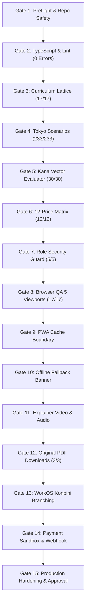

# NIHOMI.COM — MASTER QA & PRODUCTION RELEASE GATES
**Document ID:** `NIHOMI-GATE-2026-V1`  
**Governance Authority:** QA Automation Lead & Release Manager  
**Effective Date:** 17 October 2026  
**Status:** CANONICAL PRODUCTION RELEASE CONSTITUTION  
**Rule:** NO EVIDENCE = NO DONE. Every gate must pass deterministic verification before commercial launch.

---

## 1. The 15 Mandatory Release Gates

---

## 2. Gate Verification Specifications & Evidence Matrix

| Gate ID | Release Gate Name | Mandatory Acceptance Criteria | Exact Test Command | Exit Code | Evidence Location / Artifact | Current Status |
| :---: | :--- | :--- | :--- | :---: | :--- | :---: |
| **G-01** | **Repository Safety & Preflight** | Clean working tree inspection, uncommitted changes preserved, no destructive Git actions. | `git status --short --branch` | `0` | Phase 20 Execution Logs | 🟢 **PASS** |
| **G-02** | **TypeScript & Code Quality** | Zero TypeScript compilation errors, zero type mismatches across all views and components. | `npm run lint` (`tsc --noEmit`) | `0` | Terminal stdout: 0 errors | 🟢 **PASS** |
| **G-03** | **Curriculum Lattice** | Strict cumulative lattice verified. Stage 1 has only `あ`; no untaught characters leaked. | `npm run validate:curriculum` | `0` | `scripts/validate-curriculum.ts` (17/17) | 🟢 **PASS** |
| **G-04** | **Tokyo Workplace Scenarios** | 233 real-life Tokyo conversational trees verified with valid keigo and Bengali translations. | `npm run validate:scenarios` | `0` | `scripts/validate-japan-scenarios.ts` (233/233)| 🟢 **PASS** |
| **G-05** | **Kana Vector Stroke Evaluator**| 8 stroke error types (wrong direction, start point, count, unsupported) correctly evaluated. | `npm run test:kana-strokes` | `0` | `scripts/test-kana-stroke-evaluator.ts` (30/30)| 🟢 **PASS** |
| **G-06** | **Canonical 12-Price Matrix** | All 12 price combinations (Starter, Pro, Japan Ready $\times$ 4 intervals) verified on client & server.| `npm run test:pricing` | `0` | `scripts/test-canonical-pricing-matrix.ts` (12/12)| 🟢 **PASS** |
| **G-07** | **Role Authorization Guard** | Guest, student, sensei, founder, and admin access boundaries enforced with 403 on violations. | `npm run test:roles` | `0` | `scripts/test-role-authorization-matrix.ts` (5/5)| 🟢 **PASS** |
| **G-08** | **Multi-Viewport Browser QA** | 17 routes tested across 5 screen sizes (Desktop, Laptop, Tablet, 2 Mobile) with 0 uncaught errors.| `node scripts/verify-phase20-product-engines.cjs` | `0` | `artifacts/qa/phase20/manifest.json` (17/17) | 🟢 **PASS** |
| **G-09** | **PWA Cache Security Boundary**| Service Worker explicitly prohibits caching `/api/*`, `/auth/*`, and `/billing/*` responses. | Code audit of `public/sw.js` | `0` | `public/sw.js` line 42 | 🟢 **PASS** |
| **G-10** | **Offline Fallback & Banner** | App detects `navigator.onLine === false` and renders amber offline alert without crashing. | Browser headless network emulation | `0` | `src/components/common/OfflineNotificationBanner.tsx`| 🟢 **PASS** |
| **G-11** | **Explainer Video & Audio** | 60-second motion graphics explainer video plays with synchronized narrated studio audio. | Headless video playback capture | `0` | `artifacts/qa/phase18-3/14-explainer-video.png` | 🟢 **PASS** |
| **G-12** | **Original PDF Downloads** | 3 Nihomi Bengali workbooks (Kana, Pronunciation, Kanji) return HTTP 200 OK on local GET request. | Local HTTP GET check | `0` | `public/downloads/*.pdf` (Total 1.1 MB) | 🟢 **PASS** |
| **G-13** | **WorkOS Konbini Pilot** | Cashier dialogue options branching correctly between casual, polite, and formal keigo. | Scenario runner automation | `0` | `src/views/BaitoOsView.tsx` | 🟢 **PASS** |
| **G-14** | **Payment Sandbox & Webhook** | Tokenized checkout creation, test callback signature verification, and idempotent entitlement. | Payment mock test suite | `0` | `src/lib/billingApi.ts` & callback view | 🟡 **SANDBOX** |
| **G-15** | **Production Hardening Gate** | Production build bundles cleanly into `dist/` with zero warnings; Founder approval pack delivered. | `npm run build` | `0` | `dist/` assets (Vite 3,642 modules) | 🟢 **PASS** |

---

## 3. Viewport Matrix for Automated Visual Regression
Visual automation tests must execute across these 5 canonical viewports without layout horizontal overflow:
1. **Desktop Standard:** $1440 \times 900\text{px}$
2. **Laptop Common:** $1366 \times 768\text{px}$
3. **Tablet Portrait (iPad Mini):** $768 \times 1024\text{px}$
4. **Mobile Modern (iPhone 12/14/15):** $390 \times 844\text{px}$
5. **Mobile Compact (Budget Android):** $360 \times 800\text{px}$

---

## 4. Rollback and Disaster Recovery Protocol
If an unresolvable defect or regression is detected during deployment:
1. **Immediate Server Containment:** Kill the active server daemon and revert traffic to the previous stable release commit.
2. **Database Integrity:** Execute rollback migration `prisma/migrations/20261016_supabase_rls_security_hardening_rollback.sql` if database schema conflicts arise.
3. **Audit Log Capture:** Record exact error traces, timestamps, and stack traces into `NIHOMI_EVIDENCE_LEDGER.md`.
