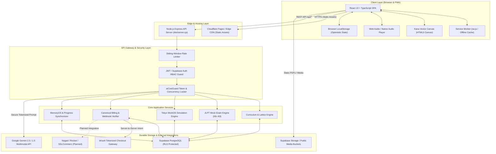

# NIHOMI.COM — SYSTEM ARCHITECTURE & TOPOLOGY MAP
**Document ID:** `NIHOMI-ARCH-2026-V1`  
**Governance Authority:** Nihomi System Architecture & Lead Product Engineer  
**Effective Date:** 17 October 2026  
**Status:** REUSABLE CANONICAL SOURCE OF TRUTH  

---

## 1. High-Level System Topology



---

## 2. Component Layer Specifications

### 2.1 Frontend Architecture
- **Framework:** React 19 with TypeScript 5.8 (Strict Mode enabled).
- **Build System:** Vite 6 with Rollup code-splitting (Output target: `dist/`).
- **Styling Engine:** Tailwind CSS v4 with bespoke Nihomi Japanese theme variables (`Deep Ink #141726`, `Washi Cream #F6F0E6`, `Lacquer Red #E45147`).
- **State Architecture:** Context API (`AuthContext`, `ThemeContext`, `FocusModeContext`, `LanguageContext`, `NomiContext`) paired with granular hook abstractions (`useSubscription`, `useVoiceSensei`).
- **Input Hardware Interfaces:** HTML5 2D Canvas with sub-pixel touch/mouse smoothing for Kana stroke capture; Web Speech API and HTML5 Audio for native pronunciation.

### 2.2 Backend & API Layer (`dist/server.cjs`)
- **Runtime:** Node.js v24.19.0 (LTS) running an Express 4 REST API service.
- **Stateless Principle:** No in-memory sessions that perish upon daemon restart. All transactional state is anchored in PostgreSQL.
- **Port & Host Binding:** Configurable via environment variables (Default: `http://127.0.0.1:3000`).
- **Health Telemetry:** `/api/health` reports status, DB latency, memory footprint (RSS/Heap), AI provider health, and gateway readiness without leaking environment secrets.

### 2.3 Security, Authorization & Middleware
- **`authGuard` Middleware:** Validates Supabase JWT bearer tokens, decodes user UUIDs, and queries the user's role (`guest`, `student`, `sensei`, `founder`, `admin`).
- **`aiCostGuard` Middleware:**
  1. Restricts unauthenticated access to generative endpoints.
  2. Implements per-user monthly token quotas based on subscription tier (`Starter: 50k`, `Pro: 250k`, `Japan Ready: 1M`).
  3. Enforces an in-flight concurrency lock (maximum 1 concurrent AI stream per user).
  4. Sliding-window rate limiting (15 requests/minute).

---

## 3. Data Storage & Schema Architecture

### 3.1 Primary Database (PostgreSQL via Supabase)
Schema managed via Prisma ORM (`prisma/schema.prisma`):
1. **`users`:** Core account records, authentication links, and global roles.
2. **`profiles`:** Learner metadata, display name, preferred study pace, and avatar URI.
3. **`lessons`:** Master curriculum catalog (Stages 1–17 and JLPT levels).
4. **`quizzes`:** Evaluated question models, prerequisite IDs, and explanation keys.
5. **`user_progress`:** Granular node mastery states, retry histories, and spaced repetition intervals.
6. **`subscriptions`:** Commercial contracts, tier (`starter`, `pro`, `japan_ready`), billing interval, expiry timestamps, and status (`active`, `past_due`, `cancelled`).
7. **`payments`:** Transaction logs, provider transaction IDs (`bKash`, `card`), BDT amounts, and verification hashes.
8. **`scenarios`:** Tokyo WorkOS simulation dialogue trees and Keigo branches.

### 3.2 Row Level Security (RLS) Protocol
- Managed via `prisma/migrations/20261016_supabase_rls_security_hardening.sql`.
- **Learner Privacy:** Students can only read and write their own `user_progress` and `profiles`.
- **Billing Security:** `payments` and `subscriptions` write permissions restricted strictly to `service_role` (backend webhook handler).
- **Founder Console:** Founder and Admin roles authenticated server-side before privileged queries are executed.

---

## 4. AI Services & Companion Engine

- **Provider:** Google Gemini 2.5 / 1.5 Multimodal API.
- **Integration Layer:** `src/core/ai/senseiProvider.ts` with local deterministic fallback logic.
- **Pedagogical Guardrail:** Dynamic Japanese text generated by the model is passed through the `journeyEngine` prerequisite filter. If the model introduces an untaught kanji or grammatical pattern, the response is rejected and routed to a pre-approved template.
- **Voice Synthesis:** Web Speech API synthesis for instant client-side playback, with prepared high-fidelity MP3/AAC audio files served from `public/audio/`.

---

## 5. Billing & Monetization Gateway

- **Pricing Engine:** `src/data/canonicalPricing.ts` (Client) and `server/services/canonicalPricing.ts` (Server) enforce the exact 12-price matrix.
- **Checkout Flow:**
  1. Client sends `create-checkout-session` with `tier` and `interval`.
  2. Server verifies price from canonical matrix and creates pending transaction row in `payments`.
  3. Server requests tokenized payment URL from payment provider.
  4. User completes payment on provider's secured checkout page.
  5. Provider calls `/api/billing/webhook` with encrypted signature.
  6. Server verifies HMAC hash, commits transaction, and grants subscription entitlement idempotently.

---

## 6. Progressive Web App (PWA) & Offline Boundary

- **Service Worker:** `public/sw.js` registers lifecycle events (Install, Activate, Fetch).
- **Caching Strategy:**
  - `Static Assets (HTML, JS, CSS, Web Fonts, Images):` Cache-First with stale-while-revalidate.
  - `Learner Workbooks & Audio:` Cache on explicit user download.
- **Security Exclusion (CRITICAL):**
  ```javascript
  // public/sw.js security boundary
  if (url.pathname.startsWith('/api/') || 
      url.pathname.includes('/auth/') || 
      url.pathname.includes('/billing/')) {
    return; // NEVER cache dynamic API responses, auth tokens, or payment data
  }
  ```
- **Offline UX:** `OfflineNotificationBanner.tsx` detects `navigator.onLine === false` and presents a non-intrusive warning indicating that local practice continues while cloud sync is queued.

---

## 7. Trust Boundaries & Verification Status

| Connection | Origin | Destination | Protocol | Status | Security Mechanism |
| :--- | :--- | :--- | :--- | :---: | :--- |
| **Browser $\rightarrow$ CDN** | Client | Cloudflare Pages | HTTPS | 🟢 VERIFIED | Static bundle, zero secrets |
| **Browser $\rightarrow$ API** | Client | Express Server | HTTPS / WSS | 🟢 VERIFIED | CORS, JWT Bearer, Rate-Limit |
| **API $\rightarrow$ Database** | Express | Supabase PostgreSQL | TLS / Pooled | 🟢 VERIFIED | Service Role Key, RLS Policies |
| **API $\rightarrow$ Gemini AI** | Express | Google Generative AI | HTTPS | 🟢 VERIFIED | Gemini API Key in Server Env |
| **API $\rightarrow$ bKash Live** | Express | bKash Tokenized API | HTTPS / HMAC | 🟡 PENDING | Sandboxed; Live Merchant Key req. |
| **PWA Cache Boundary**| Browser | Local CacheStorage | Local Sandboxed| 🟢 VERIFIED | Strict API Exclusion in sw.js |
