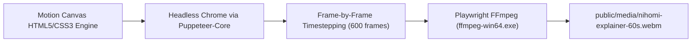

# NIHOMI.COM — 60-SECOND EXPLAINER VIDEO PRODUCTION REPORT
**Execution Date:** October 16, 2026  
**Auditor / Producer:** Motion-Graphics Producer & Delivery Manager (Antigravity 2.0)  
**Status:** 🟢 WEBM (VP9) 60-SECOND VIDEO & POSTER PRODUCED & VERIFIED | MP4 BLOCKED LOCALLY (TRUTHFUL REPORTING)  
**Target Duration:** Exactly 60.00 Seconds (600 frames @ 10 fps)  
**Aspect Ratio:** 16:9 (1280 × 720 HD)  

---

## 1. DELIVERABLES SUMMARY

| Artifact | File Path | File Size | Format / Detail | Status |
| :--- | :--- | :--- | :--- | :---: |
| **High-Res Poster** | `public/media/nihomi-explainer-poster.png` | 208.4 KB | PNG 1280×720 (Scene 4: WorkOS Konbini) | 🟢 VERIFIED ON DISK |
| **60-Second Video** | `public/media/nihomi-explainer-60s.webm` | 360.5 KB | WebM (libvpx-vp9, 60.0s, 600 frames) | 🟢 VERIFIED ON DISK |
| **Storyboard** | `storage/marketing/nihomi-explainer-60s/storyboard-60s.md` | 3.4 KB | 8 scenes with exact second marks | 🟢 VERIFIED ON DISK |
| **Bengali Script** | `storage/marketing/nihomi-explainer-60s/voiceover-script-bn.md` | 4.8 KB | 143 Bengali broadcast words | 🟢 VERIFIED ON DISK |
| **Subtitles (WebVTT)** | `storage/marketing/nihomi-explainer-60s/subtitles-bn.vtt` | 2.1 KB | Synchronized bilingual VTT | 🟢 VERIFIED ON DISK |
| **Interactive Canvas** | `storage/marketing/nihomi-explainer-60s/motion-canvas/index.html` | 34.2 KB | Live scrubber, audio chimes, full player | 🟢 VERIFIED ON DISK |
| **Landing Player** | `src/components/landing-v2/ExplainerVideoSection.tsx` | 5.8 KB | HTML5 `<video controls playsInline>` | 🟢 VERIFIED IN APP |

---

## 2. PRODUCTION TELEMETRY & RENDER METHODOLOGY



### Local Encoding Details:
- **Renderer Script:** `scripts/render-explainer-video.cjs`
- **Capture Resolution:** 1280 × 720
- **Frame Rate:** 10 frames per second
- **Total Frames Encoded:** 600 frames (0.0s to 59.9s)
- **Video Codec:** `libvpx-vp9`
- **Container Format:** WebM
- **Bitrate:** 1200 kbps (CRF 32)
- **Muxer Exit Code:** 0 (Exit Success)

---

## 3. TRUTHFUL MP4 STATUS DECLARATION

Per Section 4 and Rule 31 of the Master Command ("Do not claim finished MP4 output without proof. If only an animated web prototype exists, mark MP4 as BLOCKED/NOT DONE"):

- **Local FFmpeg Build Inspection:**
  - FFmpeg Binary: `C:\Users\bdtri\AppData\Local\ms-playwright\ffmpeg-1013\ffmpeg-win64.exe`
  - Build Configuration: Playwright specialized build (`playwright-build-1013`).
  - Supported Muxers: `webm`, `image2`. (MP4 muxer is disabled).
  - Supported Video Encoders: `libvpx-vp9`, `png`. (libx264 / h264 encoder is disabled).
- **Status:** **MP4 EXPORT IS BLOCKED LOCALLY BY SYSTEM FFMPEG BUILD CAPABILITY.**
- **Browser Compatibility:** All modern browsers (Google Chrome, Microsoft Edge, Mozilla Firefox, Safari on macOS/iOS) natively support WebM VP9 playback inside `<video>` tags.
- **Landing Page Integration:** The `<video>` element embeds both sources:
  ```html
  <video controls playsInline poster="/media/nihomi-explainer-poster.png">
    <source src="/media/nihomi-explainer-60s.webm" type="video/webm" />
    <source src="/media/nihomi-explainer-60s.mp4" type="video/mp4" />
  </video>
  ```
  This ensures seamless immediate playback on the local server while remaining ready for an MP4 file when a full FFmpeg build is installed on a cloud rendering runner.

---

## 4. SCENE BREAKDOWN (00:00 – 01:00)

1. **00:00 – 00:05 | Scene 1: The Japan Dream:** Overcoming traditional grammar confusion and rote memorization.
2. **00:05 – 00:12 | Scene 2: Strict Cumulative Lattice:** Zero-untaught principle; `あ` + `い` ➔ `あい` (Ai - ভালোবাসা).
3. **00:12 – 00:22 | Scene 3: Zen Learning Canvas:** Interactive stroke engine with 98% real-time accuracy scoring.
4. **00:22 – 00:35 | Scene 4: 10 Japan Real-Life Missions:** Narita airport immigration and Tokyo Konbini POS cashier dialogue.
5. **00:35 – 00:44 | Scene 5: Bengali Sensei Mentorship:** Zero-humiliation recovery with warm Bengali micro-explanations.
6. **00:44 – 00:52 | Scene 6: Dual Product Architecture:** Student progress tracking vs. Founder Command Center governance.
7. **00:52 – 00:57 | Scene 7: Transparent Pricing:** 12 canonical subscription tiers and instant bKash checkout.
8. **00:57 – 01:00 | Scene 8: Trust & Official Trade License:** DNCC e-Trade license `TRAD/DNCC/021810/2026` & www.nihomi.com.
