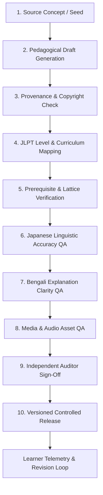

# NIHOMI.COM — INFINITE LEARNING LOOP & AI CONTENT GOVERNANCE IMPLEMENTATION PLAN

**Document ID:** `NIHOMI_INFINITE_LEARNING_LOOP_IMPLEMENTATION_PLAN`  
**Phase:** Phase 6 Product Assembly  
**Status:** 🟢 AUTHORITATIVE IMPLEMENTATION PLAN  

---

## 1. OBJECTIVE & GOVERNANCE PRINCIPLES

The **Nihomi Infinite Learning Loop** is a disciplined, multi-stage content engineering pipeline that allows Nihomi's curriculum, practice drills, and mock exams to grow systematically without ever corrupting pedagogical accuracy, introducing untaught prerequisites, or publishing unreviewed AI hallucinations.

### Non-Negotiable Governance Laws:
1. **Zero Unchecked AI Ingestion:** No raw LLM generation may bypass review and appear directly in student lessons.
2. **Cumulative Lattice Enforcement:** Every new question or drill must validate against the learner's unlocked knowledge graph.
3. **Immutable Provenance:** Every content item retains its source origin, creation timestamp, auditor signature, and version hash.
4. **No False Mastery:** Merely viewing content or clicking audio never updates completion state; mastery is awarded solely upon passing verified assessments.

---

## 2. THE 10-STAGE GOVERNED CONTENT PIPELINE

### Stage Breakdown:
- **Stage 1 (Seed):** Source concept identified from official Minna no Nihongo progression, JLPT blueprints, or verified PDF sources.
- **Stage 2 (Draft):** Draft authored with Japanese text, furigana, romaji, Bengali translation, and distractors.
- **Stage 3 (Provenance):** Verify rights; ensure no verbatim copyright infringement; tag original derivation.
- **Stage 4 (Mapping):** Map to exact JLPT band (N5 to N1) and curriculum node ID.
- **Stage 5 (Lattice Check):** Validate that every character and vocabulary item in the exercise has its prerequisite unlocked in the curriculum lattice.
- **Stage 6 (Japanese QA):** Inspect orthography, polite form consistency, particle accuracy, and natural phrasing.
- **Stage 7 (Bengali QA):** Ensure warm, clear, culturally sensitive explanation with zero shaming.
- **Stage 8 (Audio QA):** Confirm Web Speech TTS pronunciation and pitch accent correctness.
- **Stage 9 (Sign-Off):** Educator or lead architect approval logged with cryptographic hash.
- **Stage 10 (Release):** Bundled into versioned release (`content_vX.Y.Z`) and staged for learners.

---

## 3. CONTENT REVISION & MISTAKE REPAIR FEEDBACK LOOP

1. If learner telemetry shows an error rate above 70% across a cohort on a specific question, the question is automatically flagged for *Pedagogical Ambiguity Audit*.
2. If distractors are found to be misleading, the explanation is enhanced with a specific Bengali micro-tip.
3. Updated content is released with an incremented revision version (e.g. `v1.0.1`) without breaking prior student completion records.
