# NIHOMI.COM — INFINITY LEARNING LOOP CONSTITUTION
## Lifelong Japanese Mastery Without Uncontrolled or Hallucinated Content

**Constitution Version:** 1.0.0  
**Status:** Inviolable Pedagogical Standard  
**Platform:** NIHOMI.COM (にほみ)  
**Governing Rule:** `NO EVIDENCE = NO DONE`

---

## 1. THE INFINITE LEARNING LOOP ARCHITECTURE

The goal of NIHOMI is sustainable lifelong learning, continuous adaptive practice, and high-retention Japanese fluency—not the false claim that generative AI produces endless error-free lessons without human pedagogical review.

```mermaid
flowchart LR
    Observe["1. Observe Activity"] --> Diagnose["2. Diagnose Knowledge State"]
    Diagnose --> Teach["3. Teach Permitted Unit"]
    Teach --> Recall["4. Active Recall & Production"]
    Recall --> Evaluate["5. Deterministic Evaluation"]
    Evaluate --> Explain["6. Warm Bengali Feedback"]
    Explain --> Review["7. Spaced Repetition (SRS)"]
    Review --> Apply["8. Real Tokyo Scenario"]
    Apply --> Reflect["9. Evidence-Backed Mastery"]
    Reflect --> Next["10. Authoritative Next Mission"]
    Next --> Observe
```

---

## 2. TEN INVIOLABLE OPERATIONAL PRINCIPLES

1. **Observe Minimally with Consent:** Collect only necessary learner response telemetry (stroke paths, selected options, study duration, audio attempts). Never store unauthorized personal data.
2. **Diagnose Objectively:** Differentiate between claimed prior knowledge and verified demonstrated capability.
3. **Teach within Verified Prerequisite Scope:** All instructional material must strictly inherit the learner's unlocked knowledge graph. Never introduce untaught grammatical structures or kanji without explicit pedagogical scaffolding.
4. **Active Recall over Passive Consumption:** Every lesson requires active learner retrieval: stroke drawing, pronunciation imitation, typed furigana, or contextual particle selection.
5. **Deterministic Rule-Based Evaluation First:** Kana stroke evaluation, particle validation, and grammar checks must use deterministic vector comparison and canonical grammar rules before invoking AI models.
6. **Warm, Constructive Bengali Explanations:** Explanations must be empathetic, precise, and encouraging. Never shame errors; highlight the specific stroke or particle confusion and provide an immediate retry path.
7. **Evidence-Driven Spaced Repetition (MemoryOS™):** Misidentified items return into the active review queue with short intervals (1 day, 3 days); mastered items graduate to longer intervals (7 days, 14 days, 30 days).
8. **Real-Life Tokyo Cultural Application:** Learning culminates in real-life survival and professional scenarios (Tokyo Konbini, Haneda Airport, Train Stations, Job Interviews).
9. **Reflect Real Competence:** XP, badges, coins, and levels must represent verifiable work completed. Never invent fake streaks or fabricated readiness percentages.
10. **Curriculum-Grounded Next Steps:** The next recommended mission is determined by `journeyEngine.ts` following the authoritative curriculum graph, never by unvalidated generative text.

---

## 3. CONTENT INTEGRITY & AI SAFETY PROTOCOL

- All core curriculum lessons (Minna no Nihongo N5 Lessons 1–25, N4, N3, Kana sets) must originate from canonical, version-controlled JSON/TypeScript data structures (`src/data/lessons/n5MasterCurriculum.ts`).
- Generative AI (Nomi Sensei) is strictly confined to contextual assistance, pronunciation hints, and conversational roleplay.
- AI must pass through `aiCostGuard` middleware with user rate-limiting and quota controls.
- All AI-generated Japanese output presented to early learners must pass prerequisite lattice validation (`assertSenseiOutputEligible`).
