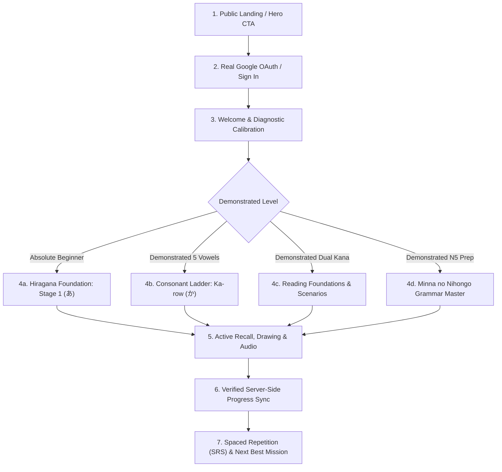

# NIHOMI.COM — LEARNER JOURNEY CONSTITUTION
## Canonical Single Source of Truth for Learner Progression, Navigation, and Knowledge State

**Constitution Version:** 1.0.0  
**Status:** Inviolable Canonical Law  
**Platform:** NIHOMI.COM (にほみ)  
**Governing Rule:** `NO EVIDENCE = NO DONE`

---

## 1. CORE PHILOSOPHY & INVIOLABLE LAWS

1. **Strict Cumulative Knowledge Lattice:**
   - A learner must NEVER encounter an untaught Japanese character, sound-symbol combination, vocabulary item, or structural unit in learner-facing content unless the prerequisite has been explicitly unlocked and verified in their personal knowledge state.
   - Stage 1 (`あ`): Only the single character `あ`. No words, no sentences.
   - Stage 2 (`い`): Known `{ あ, い }`. First word unlock: `あい` (Ai - ভালোবাসা).
   - Stage 3 (`う`): Known `{ あ, い, う }`. Unlocks `いう` (বলা), `あう` (দেখা করা).
   - Stage 4 (`え`): Known `{ あ, い, う, え }`. Unlocks `いえ` (বাড়ি), `うえ` (উপরে).
   - Stage 5 (`お`): Known `{ あ, い, う, え, お }`. Unlocks `あお` (নীল), `おおい` (অনেক).
   - Stage 5 Gate: 5-Vowel Milestone Review Gate must be passed before consonant rows (Ka-row `か`) are unlocked.

2. **Explicit Typed Navigation Invariant:**
   - Every "Next Best Mission" record MUST carry an explicit, typed destination:
     - `grammar_lesson` → designates a grammar lesson view with exact lesson ID (`n5-l1`, `n5-l2`). It MUST render the full Minna no Nihongo grammar curriculum (grammar rules, vocabulary scope, dialogues, exercises). It must NEVER be hijacked to render a Kana drawing canvas.
     - `kana_practice` → Kana Studio with exact selected Kana (e.g. `か`).
     - `vocabulary_review` → Spaced repetition vocabulary review.
     - `listening_practice` → Listening lab activity.
     - `scenario_roleplay` → Tokyo real-life scenario.
     - `placement_diagnostic` → Quick calibration engine.
   - Text label inference and generic route parsing that confuses `N5` with lesson number `5` or assumes Lesson 1 is only vowels are strictly forbidden.

3. **Mastery-Driven Progression:**
   - Self-reported skill is a placement hint, not verified mastery.
   - Verified mastery requires demonstrable proof (correct stroke drawing, passing quiz score, active recall production).
   - Unlocking is server-side and persistent per authenticated user ID.

4. **Warm Mistake Recovery:**
   - Mistakes trigger micro-explanations in warm Bengali (`detailsBn`), followed by simplified retries.
   - Repeated unresolved mistakes trigger supportive mistake repair drills.
   - Shaming, negative countdowns, or arbitrary progress wipes are forbidden.

5. **Honest Free & Paid Access:**
   - Hiragana & Katakana mastery is 100% free.
   - Minna no Nihongo N5 Lessons 1 to 5 are 100% free with complete grammar, vocabulary, audio, and exercises.
   - Lessons 6 through 25, mock exams, and advanced interview simulators are Pro/Japan Ready features.

---

## 2. CANONICAL NEW-LEARNER JOURNEY FLOW

---

## 3. IDENTITY & DATA ISOLATION

- Every learner's progress, knowledge state, coin wallet, and subscription must be partitioned strictly by authenticated `userId`.
- No client-supplied role or email may elevate access privileges.
- Founder access is strictly restricted to `AUTHORITATIVE_FOUNDER_EMAIL` (`mdtanvirkabirbiplob@gmail.com`). All other users default to Student.
- When an account logs out, all session tokens and identity markers must be purged immediately from `localStorage`, `sessionStorage`, and memory.
