# NIHOMI.COM — MASTER PRODUCT BLUEPRINT (OCTOBER 2026 CANDIDATE)

**Document ID:** `NIHOMI_MASTER_PRODUCT_BLUEPRINT`  
**Phase:** Phase 6 Product Assembly & October Production-Candidate Architecture  
**Status:** 🟢 AUTHORITATIVE SPECIFICATION  
**Author:** Lead Product Architect & System Architect  
**Workspace:** `C:\Users\bdtri\Desktop\www.Nihomi.com\nihomi-app-1`  
**Repository:** `https://github.com/nihomibd/nihomi-app.git`  
**Active Branch:** `feature/visual-landing-rebuild-v2` (HEAD: `97dd47f`)  

---

## 1. VISION & CORE VALUE PROPOSITION

> **"From zero Japanese to Japan-ready."**  
> *"Learn clearly. Practise daily. Arrive ready."*

Nihomi.com (にほみ) is Bangladesh's premier commercial Japanese learning and Japan-relocation operating system. It bridges the gap between academic memorization and real-world conversational survival in Japan.

### Target Learner Personas:
1. **Absolute Beginners:** Learners who have never seen Japanese before. Starts with Hiragana single-character vowel foundations (`あ` -> `い` -> `う` -> `え` -> `お`).
2. **Post-Kana Learners:** Learners who know kana and want structured N5 grammar, vocabulary, and listening comprehension.
3. **JLPT Candidates (N5 through N1):** Students targeting official JLPT certification with timed mock-exams, scorecards, and diagnostic weakness recovery.
4. **Relocation & Job Candidates:** Individuals preparing for Japanese work visas (SSW, TITP, Engineering, Caregiving) who need practical workplace communication (WorkOS™) and resume builders (Rirekisho).
5. **Post-N1 Professionals:** Learners who passed N1 but need to maintain active business fluency and polite keigo.

---

## 2. BRAND CONSTITUTION & DESIGN SYSTEM

All interfaces must strictly adhere to the founder-approved Brand Constitution:

### 2.1 Color Palette Balance (60 / 22 / 12 / 6 Rule):
- **Deep Ink (`#141726` / `#0a0a12`):** 60% — Primary surfaces, backgrounds, deep contrast.
- **Washi Cream (`#F6F0E6` / `#FAF9F6`):** 22% — Text readability, clean cards, paper warmth.
- **Lacquer Red (`#E45147` / `#DC2626`):** 12% — Torii accent, focal buttons, vital callouts.
- **Moss Green (`#6D7C55` / `#10B981`):** 6% — Correct mastery state, positive feedback, success indicators.
- **Supporting Accents:** Deep Plum (`#2F183A`), Neutral Slate (`#737474`), Hanabi Gold (`#F59E0B`).

### 2.2 Typography:
- **Headlines:** Helvetica Bold / Inter Display font stack.
- **UI & Body:** General Sans Variable / Inter.
- **Bengali Typography:** Noto Sans Bengali with natural line-height (1.6x).
- **Japanese Typography:** Noto Sans JP and Noto Serif JP for stroke aesthetics.

### 2.3 Tone of Voice:
- Encouraging, capable, dignified, and culturally grounded.
- Natural Bengali explanations without patronizing or baby talk.
- Zero shame upon errors; mistakes are treated as natural cognitive stepping stones.
- Zero AI hallucination of private human emotions.

---

## 3. THE LOCKED LEARNING JOURNEY & CUMULATIVE LATTICE

```mermaid
flowchart LR
    A["Enter Nihomi"] --> B["Start Journey"]
    B --> C["Quick Calibration"]
    C --> D["Starting Point"]
    D --> E["Next Best Mission"]
    E --> F["Learn (Canvas)"]
    F --> G["Recall (SRS)"]
    G --> H["Practice (Drills)"]
    H --> I["Speak (Voice)"]
    I --> J["Real-Life Use (WorkOS)"]
    J --> K["Mastery Check"]
    K --> L["Next Mission"]
```



### Strict Pedagogical Law:
- **Prerequisite Validation:** An untaught character, word, or grammar particle must NEVER appear in learner-facing drills unless it has been explicitly unlocked in the student's knowledge graph.
- **Stage 1 (`あ`):** Single character `あ`. No words, no sentences.
- **Stage 2 (`い`):** Unlocks `{ あ, い }` and the first word `あい` (Love).
- **Stage 3 (`う`):** Unlocks `{ あ, い, う }` and words `いう`, `あう`.
- **Stage 4 (`え`):** Unlocks `いえ`, `うえ`, `え`.
- **Stage 5 (`お`):** Unlocks `あお`, `おおい`, followed by the 5-Vowel Gate.
- **Anti-False-Mastery:** Passive actions (opening Sensei, playing audio, dismissing hints) never grant XP or advance mastery. Only authoritative server-evaluated submissions advance progress.

---

## 4. CANONICAL PRICING MATRIX (SINGLE SOURCE OF TRUTH)

The platform enforces exactly 12 approved pricing combinations across 3 tiers:

| Tier Key | Formal Name (EN) | Formal Name (BN) | Monthly | 3 Months | 6 Months | 12 Months |
| :--- | :--- | :--- | :---: | :---: | :---: | :---: |
| `starter` | **Nihomi Starter** | নিহোমি স্টারটার | ৳990 | ৳2,820 | ৳5,350 | ৳10,100 |
| `pro` | **Nihomi Pro** | নিহোমি প্রো | ৳1,990 | ৳5,670 | ৳10,750 | ৳20,300 |
| `japan_ready` | **Nihomi Japan Ready** | নিহোমি জাপান রেডি | ৳3,990 | ৳11,370 | ৳21,550 | ৳40,700 |

*Zero lifetime plans, zero unapproved coin grants, zero false promises of visa guarantees.*

---

## 5. SYSTEM ARCHITECTURE & COMPONENT TOPOLOGY

```
nihomi-app-1/
├── src/
│   ├── components/
│   │   ├── ai/                      # ContextualSenseiCompanion (8 states)
│   │   ├── learning/                # ZenLearningCanvas, LearnerJourneyEngine
│   │   ├── simulation/              # WorkOS Konbini, Rirekisho Studio
│   │   ├── layout/                  # Header, Footer, MobileBottomNav
│   │   └── landing-v2/              # Rebuilt Brand-Compliant Landing Page
│   ├── views/                       # 52 Active Application Views
│   ├── core/curriculum/             # curriculumGraph, journeyEngine, lattice
│   └── data/canonicalPricing.ts     # Immutable 12-price matrix
├── server/                          # Stateless Express/Node Backend
│   ├── routes/                      # payment.ts, ai.ts, curriculum.ts
│   └── services/                    # canonicalPricing.ts, db.ts
├── content-sources/                 # Verified Source Material
│   └── jlpt-mock-pdfs/              # 5 Official Mock Test PDFs (N5-N1)
├── public/                          # PWA manifest.json, sw.js (v4), assets
└── docs/nihomi-rebuild/             # Authoritative specs and evidence ledgers
```

---

## 6. RELEASE CANDIDATE GATES

Before any production deployment or release authorization:
1. **Curriculum Integrity:** 100% pass on `npm run validate:curriculum`.
2. **Scenario Integrity:** 100% pass on `npm run validate:scenarios`.
3. **Commercial Integrity:** 100% pass on `test-canonical-pricing-matrix.ts`.
4. **Security Integrity:** 100% pass on `test-role-authorization-matrix.ts`.
5. **Build Integrity:** Zero-warning build output in `dist/`.
6. **Browser QA:** Zero fatal console errors, responsive viewports (360px to 1440px), real screenshot proof.
7. **Founder Sign-Off:** Explicit, written authorization from the founder.
