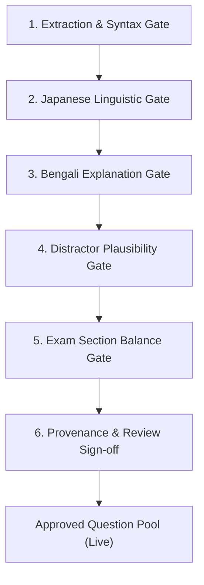

# NIHOMI.COM — JLPT MOCK-TEST ENGINE QUALITY GATE SPECIFICATION

**Document ID:** `NIHOMI_MOCK_TEST_QUALITY_GATE`  
**Phase:** Phase 6 Product Assembly  
**Status:** 🟢 AUTHORITATIVE QUALITY PROTOCOL  

---

## 1. QUALITY ASSURANCE PHILOSOPHY

To protect learners from inaccurate questions, confusing distractors, or bad answer keys, every question in the Nihomi Mock-Test Engine must pass a 6-stage Quality Gate before being published to student exam sessions.

---

## 2. THE 6-STAGE QUALITY GATE PROTOCOL

### Stage 1: Extraction & Syntax Gate
- Prompt text must be non-empty and well-formed.
- Exactly 4 choices must be present (or 3 for specific listening questions).
- Exactly one correct choice must be flagged.
- No duplicate options permitted within the same question.

### Stage 2: Japanese Linguistic Gate
- Kanji characters, furigana, and punctuation (`。`, `、`, `「」`) must be standard Japanese orthography.
- Level appropriateness: An N5 question must not use N3 grammar patterns or untested kanji unless furigana is provided.

### Stage 3: Bengali Explanation Gate
- Explanation must clearly state why the correct answer is right in natural Bengali.
- Explanation must explain why common mistakes happen without shaming the student.

### Stage 4: Distractor Plausibility Gate
- Distractors must represent genuine phonetic, orthographic, or grammatical pitfalls (e.g. `い` vs `り`, `あ` vs `お`, particle confusion `に` vs `で`).
- Random or nonsensical options are strictly rejected.

### Stage 5: Exam Section Balance Gate
- An exam must represent the full spread of required JLPT topics (Kanji readings, orthography, contextual vocab, sentence order `★`, reading comprehension).
- Time limits must strictly conform to official exam allocations.

### Stage 6: Provenance & Review Sign-off Gate
- Question must carry immutable metadata linking to original source page in `content-sources/jlpt-mock-pdfs/`.
- Must be signed off with reviewer ID and extraction version.

---

## 3. AUDIT RULE & ZERO-TOLERANCE POLICY

If a question contains a typographical error, ambiguous phrasing, or conflicting answer key:
1. It is immediately flagged as `quarantined`.
2. It is removed from active student testing rotations.
3. It cannot be re-activated without manual correction and re-validation.
