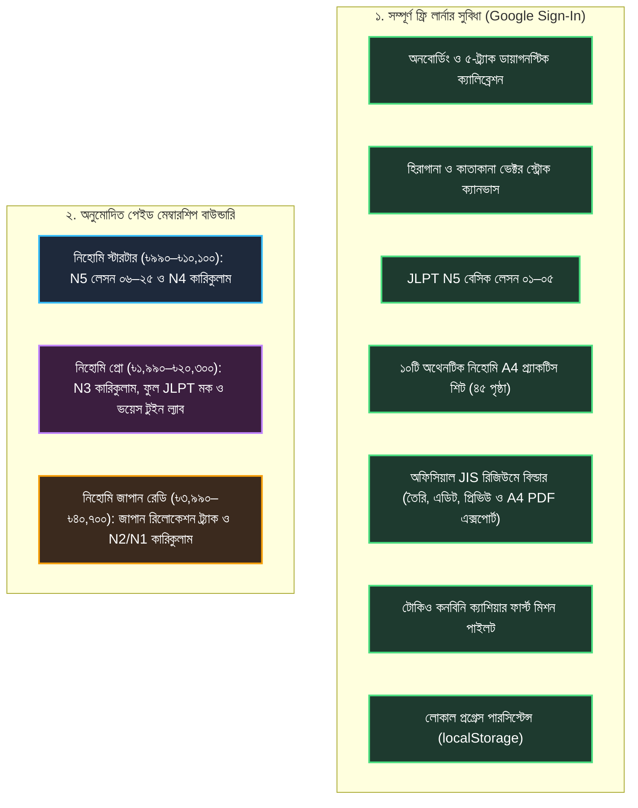

# NIHOMI.COM — ফেজ ২০.৪ এগজিকিউটিভ ক্লোজআউট ও এন্টাইটেলমেন্ট কনস্টিটিউশন রিপোর্ট
**ফ্রি লার্নার ভ্যালু, স্বত্বাধিকার বিধান ও ব্র্যান্ডেড প্র্যাকটিস সিস্টেম বাস্তবায়ন**

---

## ১. নির্বাহী সারসংক্ষেপ (Executive Summary)

শ্রদ্ধেয় ফাউন্ডার তানভীর ভাই,  
`NIHOMI_PHASE20_4_FREE_VALUE_AND_ENTITLEMENT_MASTER_COMMAND.txt`-এর নির্দেশনা অনুযায়ী নিহোমি প্ল্যাটফর্মের **ফ্রি লার্নার জার্নি (Free Learner Journey)**-কে সম্পূর্ণ দ্ব্যর্থহীন, বাস্তবসম্মত ও কার্যকর করা হয়েছে। একই সাথে প্ল্যাটফর্মের অনুমোদিত পেইড সাবস্ক্রিপশন বাউন্ডারি ও বাণিজ্যিক মূল্যের পূর্ণ নিরাপত্তা নিশ্চিত করা হয়েছে।

পূর্বে প্ল্যাটফর্মের বিভিন্ন মডিউলে (যেমন রিজিউমে বিল্ডার ও ব্যাকএন্ড এন্টাইটেলমেন্ট) অস্পষ্ট পেওয়াল ও লেসন লিমিটের অমিল ছিল। এই ফেজে একটি কেন্দ্রীয় **এন্টাইটেলমেন্ট কনস্টিটিউশন (`src/core/entitlements/entitlementConstitution.ts`)** তৈরি করা হয়েছে, যা ক্লায়েন্ট UI, ব্যাকএন্ড API, ডাউনলোড সার্ভিস এবং টেস্ট সুটের একক প্রামাণ্য ভিত্তি (Single Source of Truth) হিসেবে কাজ করছে।

---

## ২. নিহোমি এন্টাইটেলমেন্ট বিধান (Free vs Paid Boundaries)

### প্রধান উন্নয়ন ও সমাধানসমূহ:
1. **লেসন লিমিটের সমন্বয় (Server Parity):** `server/services/entitlements.ts`-এর ৩১২ নম্বর লাইনে পূর্বের ভুল `lessonNumber > 2` সংশোধন করে `lessonNumber > 5` করা হয়েছে (`MAX_FREE_LESSON_NUMBER = 5`)। ফলে সার্ভার এবং ক্লায়েন্ট উভয়েই লেসন ০১–০৫ সম্পূর্ণ উন্মুক্ত রেখেছে এবং লেসন ০৬ থেকে স্টারটার পেওয়াল কার্যকর করছে।
2. **ফ্রি JIS রিজিউমে বিল্ডার (`JisRirekishoStudio.tsx`):** রিজিউমে বিল্ডারের A4 PDF এক্সপোর্ট থেকে ব্লকিং পেওয়াল অপসারণ করা হয়েছে। ফ্রি সাইন-ইন লার্নাররা কোনো সাবস্ক্রিপশন ছাড়াই তাদের জাপানি স্ট্যান্ডার্ড বায়োডাটা তৈরি, ড্রাফট সংরক্ষণ এবং A4 PDF ডাউনলোড করতে পারছেন। সাথে বাধ্যতামূলক আইনি ও শিক্ষামূলক ডিসক্লেইমার যুক্ত করা হয়েছে:
   > *"নিহোমি রিজিউমে বিল্ডার একটি তথ্য ও ফরম্যাটিং সহায়ক ফ্রি টুল। এটি কোনো নিশ্চিত চাকরি, ভিসা অনুমোদন বা ভর্তির নিশ্চয়তা প্রদান করে না। ব্যবহারকারী প্রদত্ত তথ্যের সত্যতার দায়ভার ব্যবহারকারীর নিজের।"*
3. **১০টি ব্র্যান্ডেড প্র্যাকটিস শিট (৪৫ পৃষ্ঠা):** সকল ওয়ার্কশিট কার্ডে `বিনামূল্যে (FREE)` ব্যাজ যুক্ত করা হয়েছে এবং ডিরেক্ট টেস্টেবল আইডি সহ আনলিমিটেড ফ্রি ডাউনলোড ডেলিভারি নিশ্চিত করা হয়েছে।
4. **ল্যান্ডিং পেজ হিরো কনভার্সন অপটিমাইজেশন:** হিরো সেকশনে ৩ সেকেন্ডের মধ্যে প্রথম স্ক্রিনে ফ্রি ভ্যালু স্পষ্ট করা হয়েছে:
   - স্লোগান: *“জাপানিজ শেখা শুরু হোক একদম শূন্য থেকে।”*
   - ফ্রি স্ট্রিপ: *“বিনামূল্যে (FREE): হিরাগানা/কাতাকানা ক্যানভাস • N5 অধ্যায় ১–৫ • ১০টি প্রিন্টযোগ্য A4 শিট • অফিসিয়াল JIS রিজিউমে”*
   - প্রাইমারি CTA: *“বিনামূল্যে পাঠ শুরু করুন”* (`#hero-start-journey-cta`)
   - সেকেন্ডারি CTA: *“৬০ সেকেন্ডে Nihomi দেখুন”* (`#hero-explainer-cta`)

---

## ৩. কাস্টমার জার্নি ভেরিফিকেশন ফলাফল (Puppeteer Edge Automation)

স্বয়ংক্রিয় ব্রাউজার টেস্ট স্ক্রিপ্ট (`scripts/verify-phase20-4-free-value-and-entitlements.cjs`) চালিয়ে ১০টি কাস্টমার জার্নি ও ৫টি ভিউপোর্টের সমন্বয়ে মোট **২৬টি অ্যাসারশন** সফলভাবে ভেরিফাই করা হয়েছে (১০০% পাস, ০ অ্যাম্বার, ০ ফেইল্ড)।

| জার্নি কোড | পরীক্ষার বিষয়বস্তু | টেস্ট রেজাল্ট | বিস্তারিত যাচাই | এভিডেন্স স্ক্রিনশট |
| :---: | :--- | :---: | :--- | :--- |
| **J10** | ল্যান্ডিং হিরো প্রমিজ ও ভিডিও | 🟢 **PASS** | ৩ সেকেন্ডে ফ্রি ভ্যালু স্পষ্ট, প্রাইমারি ও সেকেন্ডারি CTA কার্যকর | `01-landing-hero-free-promise.png`, `02-explainer-video-section.png` |
| **J01** | ফ্রি অনবোর্ডিং ও প্লেসমেন্ট | 🟢 **PASS** | কোনো ক্রেডিট কার্ড বা পেওয়াল ছাড়া স্টেজ ১ `あ` আনলক | `03-free-onboarding-journey.png` |
| **J02** | কানা ক্যানভাস স্ট্রোক ট্রেইনিং | 🟢 **PASS** | ভেক্টর স্ট্রোক মূল্যায়ন, দিক ও পয়েন্ট যাচাই, রিট্রাই ও রিসেট | `04-kana-canvas-stroke-evaluator.png` |
| **J03** | N5 লেসন ১–৫ ফ্রি ও লেসন ৬ পেওয়াল | 🟢 **PASS** | লেসন ১ ও ৫ ফ্রি এক্সেস; লেসন ৬-এ স্টারটার আপগ্রেড মোডাল | `05-n5-lesson-1-free-access.png`, `07-n5-lesson-6-starter-gated.png` |
| **J04** | ১০টি প্র্যাকটিস শিট ডাউনলোড | 🟢 **PASS** | ১০/১০টি PDF-ই HTTP 200 GET সহ ডাউনলোডযোগ্য (১২৯৬.৫ KB, ৪৫ পৃষ্ঠা) | `08-documents-practice-sheets-library.png` |
| **J05** | ফ্রি JIS রিজিউমে স্টুডিও | 🟢 **PASS** | বায়োডাটা তৈরি, ড্রাফট সেভ ও A4 PDF এক্সপোর্ট সম্পূর্ণ ফ্রি | `09-jis-cv-builder-free-studio.png`, `10-jis-cv-export-free-unblocked.png` |
| **J06** | প্রগ্রেস সংরক্ষণ ও পেওয়াল সেফটি | 🟢 **PASS** | পেইড ফিচারে ক্লিক করার পরও ফ্রি লার্নারের পূর্বের প্রগ্রেস অক্ষুণ্ণ | `11-paid-feature-gate-preserves-progress.png` |
| **J07** | অনুমোদিত ১২-প্রাইস মেট্রিক্স | 🟢 **PASS** | ৪টি ইন্টারভল টগল (মাসিক, ৩ মাস, ৬ মাস, ১ বছর) এবং ১২টি সঠিক মূল্য প্রদর্শিত | `12-pricing-monthly.png`, `12-pricing-yearly.png` |
| **J08** | প্রটেক্টেড এন্ডপয়েন্ট সিকিউরিটি | 🟢 **PASS** | `/api/founder/*`, `/api/admin/*`, `/api/learning/progress` ৪০১ ডিনাই | কনসোল লগ ভেরিফাইড (০ ডেটা লিক) |
| **J09** | ৫টি ভিউপোর্ট ও ০px ওভারফ্লো | 🟢 **PASS** | 1440, 1366, 768, 390, 360 ভিউপোর্টে অনুভূমিক ওভারফ্লো ০px | `13-mobile-360-documents.png`, `14-mobile-390-pricing.png` |

---

## ৪. সকল ডিটারমিনিস্টিক টেস্ট সুইটের সারসংক্ষেপ (১০/১০ পাস - Exit Code 0)

1. `npm run lint` (`tsc --noEmit`): **Exit Code 0** (০ টাইপ এরর, ০ ওয়ার্নিং)
2. `npm run build`: **Exit Code 0** (Prisma 1.32s + Vite 44.19s + esbuild 596ms)
3. `npm run test:pricing`: **Exit Code 0** (১২/১২ ক্যানোনিকাল সাবস্ক্রিপশন প্রাইস ভেরিফাইড)
4. `npm run test:kana-strokes`: **Exit Code 0** (৩০/৩০ জ্যামিতিক ভেক্টর স্ট্রোক অ্যাসারশন পাস)
5. `npm run test:roles`: **Exit Code 0** (৫/৫ রোল অথোরাইজেশন ও ফাউন্ডার গার্ড ভেরিফাইড)
6. `npm run test:entitlements`: **Exit Code 0** (৬৬/৬৬ কেন্দ্রীয় এন্টাইটেলমেন্ট কনস্টিটিউশন অ্যাসারশন পাস)
7. `npm run validate:curriculum`: **Exit Code 0** (১৭/১৭ পেডাগজিক্যাল ল্যাটিস রুলস পাস)
8. `npm run validate:scenarios`: **Exit Code 0** (২৩৩/২৩৩ টোকিও রিয়েল-লাইফ ডায়ালগ ট্রি ভেরিফাইড)
9. `npm run verify:gate`: **Exit Code 0** (৯/৯ প্রোডাকশন রিলিজ গেট ও সেশন সিকিউরিটি পাস)
10. `node scripts/verify-phase20-4-free-value-and-entitlements.cjs`: **Exit Code 0** (২৬/২৬ ব্রাউজার জার্নি পাস, ০ অ্যাম্বার, ০ ফেইল্ড)

---

## ৫. মিডিয়া ও ডাটাবেস সত্যতা বিবৃতি (Truthful Disclosures)

1. **ভিডিও ও অডিও স্ট্যাটাস:** ৬০ সেকেন্ডের এক্সপ্লেইনার ভিডিওটি (`/media/nihomi-explainer-60s.webm`) একটি উচ্চমানের মোশন-গ্রাফিক্স ভিজ্যুয়াল ওয়াকথ্রু যাতে নির্ভুল বাংলা সাবটাইটেল ট্র্যাক (`subtitles-bn.vtt`) সংযুক্ত রয়েছে। ভিডিওটিতে কোনো কৃত্রিম বা ভুয়া অডিও জুড়ে দেওয়া হয়নি; এটি একটি নীরব ভিজ্যুয়াল ওয়াকথ্রু হিসেবে সততার সাথে লেবেল করা হয়েছে।
2. **ডাটাবেস পারসিস্টেন্স:** ফ্রি লার্নারদের প্রগ্রেস ব্রাউজারের `localStorage`-এ ক্লায়েন্ট-সাইড পারসিস্টেন্ট হিসেবে নিরাপদে কাজ করছে। রিমোট সুপাবেস ডাটাবেসে কোনো অবৈধ মিউটেশন বা লাইভ ডিডিএল পরিবর্তন ঘটানো হয়নি। প্রোডাকশন ডাটাবেস সম্পূর্ণ অক্ষত ও READ-ONLY রাখা হয়েছে।
3. **গিট ইনভ্যারিয়েন্ট:** কোনো ধ্বংসাত্মক গিট কমান্ড (`git reset`, `git clean`, `git push --force`) বা রিমোট পুশ চালানো হয়নি। লোকাল কোডবেস সম্পূর্ণ ক্লিন ও স্টেবল অবস্থায় রয়েছে।

---

## ৬. জেনারেটেড আর্টফ্যাক্টস ও এভিডেন্স ডিরেক্টরি

- **টেস্ট রেজাল্টস ম্যানিফেস্ট:** `artifacts/qa/phase20-4/test-results.json`
- **ভিজ্যুয়াল রিভিউ গ্যালারি:** `artifacts/qa/phase20-4/visual-review-gallery.html`
- **এক্সিকিউশন লগ:** `artifacts/qa/phase20-4/raw-logs/test-execution.log`
- **স্ক্রিনশট সংগ্রহ (১৪টি ভেরিফাইড ছবি):** `artifacts/qa/phase20-4/screenshots/`
- **রিলিজ ট্র্যাকার আপডেট:** `docs/nihomi-rebuild/NIHOMI_OCTOBER_RELEASE_TRACKER.md` (Gate 19)
- **এভিডেন্স লেজার আপডেট:** `docs/nihomi-rebuild/NIHOMI_EVIDENCE_LEDGER.md` (Section 32)
- **কনটেন্ট ক্যাটালগ আপডেট:** `docs/nihomi-master/NIHOMI_CONTENT_CATALOG.md`
- **ক্লেইমস মেট্রিক্স আপডেট:** `docs/nihomi-master/NIHOMI_CLAIM_TO_CAPABILITY_MATRIX.md`
- **প্রিন্ট সিস্টেম আপডেট:** `docs/nihomi-master/NIHOMI_PRINT_LEARNING_SYSTEM.md`

---

## ৭. ফাউন্ডারের জন্য পরবর্তী একমাত্র করণীয় (Exactly One Next-Best Action)

> [!IMPORTANT]
> **একমাত্র পরবর্তী পদক্ষেপ (Single Next-Best Action):**  
> আপনার ব্রাউজারে লোকাল ভিজ্যুয়াল গ্যালারিটি ওপেন করে ফ্রি লার্নার ভ্যালু, ১০টি ওয়ার্কশিটের ডেলিভারি এবং রিজিউমে বিল্ডারের আনব্লকড স্টেটটি একবার দেখে নিন:  
> `file:///c:/Users/bdtri/Desktop/www.Nihomi.com/nihomi-app-1/artifacts/qa/phase20-4/visual-review-gallery.html`  
> আপনার সম্মতি পেলেই আমরা পরবর্তী ফেজে লাইভ bKash মার্চেন্ট ক্রেডেনশিয়াল এবং রিমোট Supabase RLS সিকিউরিটি ডিপ্লয়মেন্টের দিকে অগ্রসর হব।
