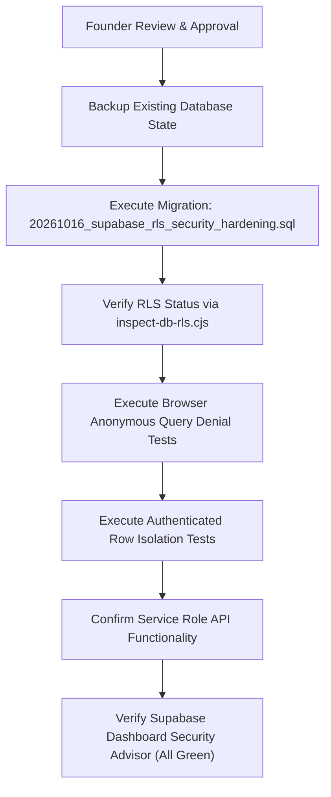

# NIHOMI.COM — PHASE 7 SUPABASE SECURITY REMEDIATION PLAN
**Target Environment:** Production Supabase `aiychtkhktwsjrieeaha` (`supabase-charcoal-garden`)  
**Prepared By:** Lead Systems Architect & Security Engineer  
**Date:** October 16, 2026  
**Status:** DRAFT PREPARED & TESTED LOCALLY — PENDING FOUNDER LIVE EXECUTION APPROVAL

---

## 1. EXECUTIVE SUMMARY

Supabase Security Advisor issued alert `rls_disabled_in_public` on project `aiychtkhktwsjrieeaha`.  
Telemetry shows 27 tables in schema `public` with Row Level Security disabled, including tables with sensitive live data (`User`, `Payment`).

This document outlines the step-by-step remediation plan to lock down all 27 tables, revoke broad privileges from `anon` and `PUBLIC`, grant least-privilege access, and establish row-level ownership policies without disrupting legitimate application traffic.

---

## 2. AFFECTED TABLES CLASSIFICATION & ACCESS MODEL

### Category A: Public Educational Content (Read-Only to Public, Write to Service Role)
- Tables: `"Course"`, `"Module"`, `"Lesson"`, `"LessonItem"`, `"Vocabulary"`, `"Grammar"`, `"Kanji"`, `"Quiz"`, `"QuizQuestion"`
- **Intended Access:**
  - `anon` / `authenticated`: `SELECT` allowed on published items.
  - `anon` / `authenticated`: `INSERT`, `UPDATE`, `DELETE`, `TRUNCATE` strictly denied.
  - `service_role`: Full CRUD for administrative backend & content pipelines.

### Category B: Learner-Owned Private Data (Strict Row-Level Isolation)
- Tables: `"User"`, `"Profile"`, `"LessonProgress"`, `"LearningProgress"`, `"MistakeRecord"`, `"QuizAttempt"`, `"Subscription"`, `"Invoice"`, `"UsageRecord"`
- **Intended Access:**
  - `anon`: Denied all access.
  - `authenticated`: Restricted to rows where `auth.uid() = id` (or `auth.uid() = "userId"`).
  - `service_role`: Full management for auth sync, background scoring, and webhook triggers.

### Category C: Internal Financial & Webhook Data (Zero Browser Direct Access)
- Tables: `"Payment"`, `"PaymentAttempt"`, `"WebhookEvent"`, `"SubscriptionEvent"`, `"AdminAuditLog"`, `"Coupon"`, `coin_transactions`, `coin_wallets`, `nihomi_reward_events`
- **Intended Access:**
  - `anon`: Denied all access (`REVOKE ALL`).
  - `authenticated`: 
    - `"Payment"`: Read-only `SELECT` where `auth.uid() = "userId"` (student receipt view).
    - `"Coupon"`: Read-only `SELECT` where `"isActive" = true` (coupon redemption check).
    - Others: Denied all direct browser queries.
  - `service_role`: Exclusive authority to process payment callbacks, write audit trails, and update subscriptions.

---

## 3. REMEDIATION STEP-BY-STEP WORKFLOW

### Pre-requisites & Founder Safeguards:
1. **Safety Rule:** No deletion or modification of existing rows.
2. **Rollback Script Available:** `prisma/migrations/20261016_supabase_rls_security_hardening_rollback.sql`.
3. **Execution Options:**
   - **Option 1 (Recommended):** Founder approves execution through Antigravity CLI.
   - **Option 2:** Founder copies SQL into Supabase Studio SQL Editor and clicks Run.

---

## 4. VERIFICATION TEST SUITE

After execution, the following verification checks will be run:
1. `node scripts/inspect-db-rls.cjs`:
   - Expected output: `Tables WITHOUT RLS in migration: 0`.
   - All 45 tables must show `rowsecurity = true`.
2. Anonymous test script (`scripts/test-rls-anon-denial.cjs`):
   - Anonymous `SELECT * FROM "Payment"` must return 0 rows or error.
   - Anonymous `SELECT * FROM "User"` must return 0 rows or error.
   - Anonymous `SELECT * FROM "Lesson"` must successfully return lesson rows.
3. Authenticated test:
   - Authenticated student A cannot read student B's `LessonProgress` or `Subscription`.
4. Backend API check:
   - Server `/health` and payment webhook endpoints continue processing via `service_role`.

---

## 5. AUTH SETTING: LEAKED PASSWORD PROTECTION

- In addition to table RLS, Supabase Auth offers **Leaked Password Protection** (checking passwords against HaveIBeenPwned).
- **Location in Supabase Studio:** `Authentication` ➔ `Providers` / `Password Security` ➔ `Enable Leaked Password Protection`.
- **Founder Action Required:** Toggle this setting in Supabase Studio. It does not disrupt existing active sessions or invalidate current passwords, but prevents learners from adopting compromised passwords upon registration or password reset.
