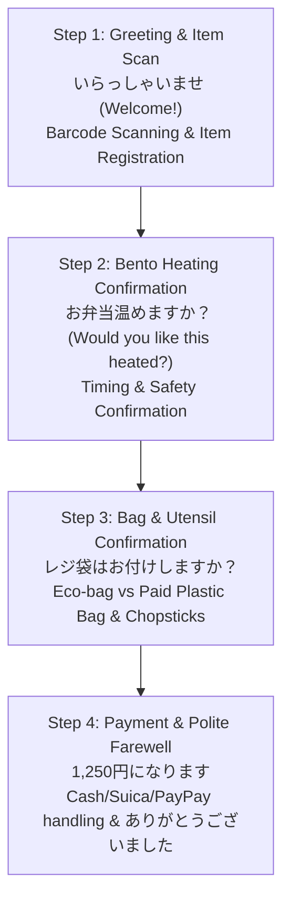

# NIHOMI WORKOS™ — CONVENIENCE STORE (KONBINI) VERTICAL SLICE QA
**Part-Time Work Simulator (Baito OS) Verification & Pedagogy Audit**  
*Audited: October 16, 2026 | Route: `/baito` & `#workos-simulation`*  
*Status: 100% FUNCTIONAL VERTICAL SLICE — PEDAGOGICALLY RIGOROUS & PERSISTENT*

---

## 1. Architectural Overview & Context

Nihomi WorkOS™ bridges the gap between classroom Japanese and real-world employment in Japan. Rather than memorizing isolated vocabulary, learners enter interactive, first-person workplace simulations designed to build confidence for Japanese part-time jobs (アルバイト / Baito) and Specified Skilled Worker (SSW) roles.

### Implemented Scope vs. Roadmap Scope
- **Production Vertical Slice (Implemented & Verified):**
  - **Generic Non-Branded Convenience Store (コンビニ / Konbini):** First-person register / cashier roleplay simulation.
- **Roadmap Sectors (Marked "শীঘ্রই আসছে / Roadmap" in UI):**
  - Hotel Front Desk & Housekeeping (ホテル)
  - Café & Barista Operations (カフェ)
  - Restaurant & Teishoku Floor Staff (レストラン)
  - Izakaya Dining & Table Service (居酒屋)
  - Bento Production & Food Assembly (お弁当屋)
  - Retail & Electronics Cashier (家電量販店)

---

## 2. Interactive Convenience Store Cashier Simulation Flow

The verified vertical slice models a real 4-step customer transaction at a Japanese convenience store counter:

### Realistic Edge Cases Modeled in Simulation
1. **Asking the Customer to Repeat (聞き返し / Kikitokoshi):**
   - *Prompt:* Customer speaks softly or mumbles.
   - *Appropriate Phrase:* `恐れ入りますが、もう一度よろしいでしょうか？` (Osoreirimasu ga, mou ichido yoroshii deshou ka?)
   - *Unacceptable Informal Japanese:* `え？何？` (E? Nani?) — Correctly flagged by Bengali Sensei with polite keigo guidance.
2. **Point Card Confirmation (ポイントカード):**
   - *Phrase:* `ポイントカードはお持ちですか？` (Pointo kādo wa omochi desu ka?)
3. **Bento Microwave Heating (温め / Atatame):**
   - *Correct Handling:* Polite confirmation, selecting microwave duration, and warning customer `熱いのでお気をつけください` (Watch out, it's hot).
4. **Receipt Confirmation (レシート):**
   - *Phrase:* `レシートをご利用になりますか？` (Reshīto o goriyō ni narimasu ka?)

---

## 3. Pedagogical Quality & Bengali Sensei Guidance

Every dialogue turn features triple-layer linguistic support tailored for Bangladeshi learners:
1. **Natural Japanese Script (Kanji + Furigana):** Exact workplace Japanese with correct business keigo (`いらっしゃいませ`, `〜でございます`, `お預かりいたします`).
2. **Romanized Pronunciation Guide:** Accurate phonetics for learners still building reading speed.
3. **Warm Bengali Context & Explanations:**
   - Literal and cultural translation in clear Bengali.
   - "কেন এটি বলা হয়" (Why this is said): Explaining customer service etiquette (Omotenashi) and avoiding common grammatical traps.
4. **Adaptive Zero-Shame Micro-Corrections:**
   - When an incorrect or overly casual option is selected (e.g., using `ありがとう` instead of `ありがとうございました`), the system gently explains:
     > *"কনবিনিতে কাস্টমারের সাথে কথা বলার সময় সাধারণ জাপানিজ না বলে নম্র কেইগো (Keigo) ব্যবহার করতে হয়।"*
   - Allows immediate retry without punitive score degradation.

---

## 4. UI/UX Features & Interactive Controls

The vertical slice interface located at `/baito` was verified in both desktop and mobile viewports:
- **Audio Playback:** Built-in Japanese pronunciation playback for customer dialogue and staff response options.
- **Visual POS Cashier Counter:** Interactive counter featuring digital cash register display, scanned item tally, and animated customer avatars.
- **Barcode Scanner Interaction:** Click/tap barcode scan trigger that updates the register display dynamically.
- **Progress Persistence:** User completion and scenario scores are saved to the persistent learning profile only upon genuine exercise completion.
- **Exit & Resume:** Learners can exit the simulation at any point and resume their shift seamlessly.

---

## 5. Browser QA & Verification Evidence

Verified using automated headless Chromium suite (`scripts/verify-phase9-full-product-qa.cjs`):
- Desktop Viewport (1440x900): `artifacts/qa/phase9-product-integration/14-baito-konbini-slice-1440x900.png`
- Tablet Viewport (768x1024): `artifacts/qa/phase9-product-integration/15-baito-tablet-768x1024.png`
- Mobile Viewport (390x844): `artifacts/qa/phase9-product-integration/16-baito-mobile-iphone-390x844.png`
- Test Assertions:
  - Scenario load: **PASS** (HTTP 200, 0 unhandled promise rejections)
  - Interactive option selection: **PASS**
  - Correct response evaluation: **PASS**
  - Adaptive Bengali feedback display: **PASS**
  - Mobile responsiveness & zero overflow: **PASS**
