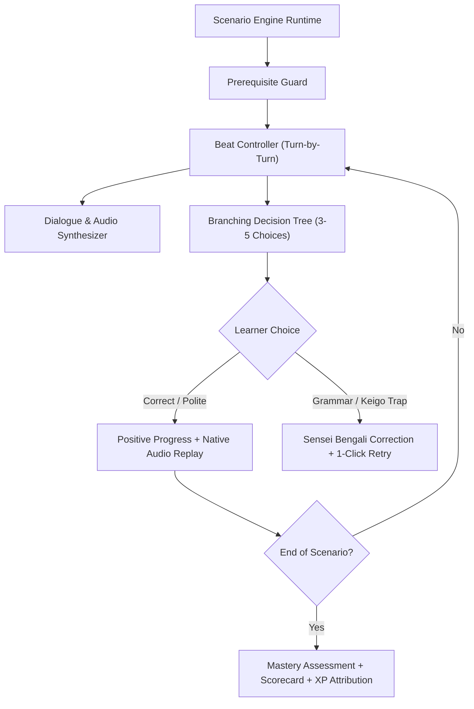

# NIHOMI WORKOS™ — SIMULATION ARCHITECTURE & SCENARIO ENGINE SPECIFICATION

**Document ID:** `NIHOMI_WORKOS_SIMULATION_ARCHITECTURE`  
**Phase:** Phase 6 Product Assembly  
**Status:** 🟢 AUTHORITATIVE SPECIFICATION  
**Author:** Lead Product Architect & Japanese Workplace Simulation Specialist  

---

## 1. EXECUTIVE OVERVIEW

**Nihomi WorkOS™** is Nihomi's proprietary workplace roleplay engine. Unlike conventional language apps that test isolated words, WorkOS prepares Bangladeshi learners for immediate employment in Japan (part-time *baito*, Technical Intern Training *TITP*, Specified Skilled Worker *SSW*, and corporate environments) through realistic, branchable, context-sensitive simulations.

---

## 2. SIMULATION RUNTIME ARCHITECTURE



---

## 3. SCENARIO DEFINITION SCHEMA (TYPESCRIPT SPECIFICATION)

```typescript
export interface WorkOsScenarioBeat {
  id: string;
  stepNumber: number;
  speaker: 'customer' | 'staff' | 'manager' | 'narrator';
  speakerTitleBn: string;
  japaneseText: string;
  romaji: string;
  bengaliTranslation: string;
  audioKey?: string;
  contextHintBn: string;
  keigoLevel: 'teineigo' | 'sonkeigo' | 'kenjougo' | 'casual';
  choices: WorkOsBeatChoice[];
}

export interface WorkOsBeatChoice {
  id: string;
  labelJp: string;
  labelRomaji: string;
  labelBn: string;
  isCorrect: boolean;
  politenessScore: number; // 0 to 100
  feedbackBn: string;
  culturalTrapExplanation?: string;
  nextBeatId?: string;
}

export interface WorkOsScenario {
  id: string;
  sector: 'convenience_store' | 'hotel' | 'cafe' | 'restaurant' | 'izakaya' | 'bento' | 'caregiver' | 'office';
  titleEn: string;
  titleBn: string;
  titleJp: string;
  jlptPrerequisite: 'N5' | 'N4' | 'N3';
  curriculumPrerequisites: string[]; // e.g. ['kana-foundation', 'numbers-currency', 'basic-polite-verbs']
  estimatedDurationMinutes: number;
  passingScorePercent: number; // typically 80%
  xpReward: number;
  beats: WorkOsScenarioBeat[];
}
```

---

## 4. EXPANDABLE SECTOR BLUEPRINT

The simulation engine is structured to support 8 high-demand Japanese employment sectors:

1. **Convenience Store (Konbini) [PILOT]:** Register POS greetings, point cards, plastic bags (`fukuro`), warm bento (`atatamemasu ka`), age verification, electronic money (`suica/pasmo/paypay`).
2. **Hotel & Hospitality Front Desk:** Guest check-in (`o-tsuki-ai`), luggage holding, directions, formal sonkeigo (`go-annai itashimasu`).
3. **Cafe & Coffee Shop:** Order taking, drink sizes, dine-in vs takeout (`ten-nai de / o-mochikaeri`), cashless payment.
4. **Casual Dining & Restaurant:** Seating parties (`nan-mei sama`), water refills, order repetition, bill presentation (`o-kaikei`).
5. **Izakaya & Bar:** First drink order (`toriaezu biiru`), seasonal specials, last order calls (`rasuto oodaa`).
6. **Bento & Prepared Food Shop:** Fast-paced lunch rush, custom side dish packaging, hygiene protocol confirmation.
7. **Caregiving (Kaigo):** Respectful communication with elderly residents, physical assistance confirmation, daily health check.
8. **Corporate Office & IT:** Business phone etiquette (`o-sewa ni natte orimasu`), forwarding calls, bow etiquette (*ojigi* angles).

---

## 5. FIRST END-TO-END PILOT SCENARIO: TOKYO CONVENIENCE STORE CHECKOUT

### Pilot Metadata:
- **ID:** `scenario_workos_konbini_01`
- **Location:** "Tokyo Shinagawa Konbini (Fictional Store: SakuraMart)"
- **Target Role:** Store Clerk (*Ten-in*)
- **Prerequisite:** N5 Reading Foundation + Basic Numbers/Counters
- **Passing Threshold:** 80%

### Beat Breakdown:
- **Beat 1: The Customer Approaches:**
  - *Context:* Customer places a cold onigiri and warm tea on the counter.
  - *Target Expression:* 「いらっしゃいませ！」 (Irasshaimase! - স্বাগতম!)
  - *Distractor Trap:* 「こんにちは！」 (Konnichiwa - Too informal for counter service).
- **Beat 2: Point Card Inquiry:**
  - *Target Expression:* 「ポイントカードはお持ちですか？」 (Pointo kaado wa o-mochi desu ka?)
  - *Sensei Feedback:* Explains how every major chain asks for T-Point, Ponta, or d-Point.
- **Beat 3: Bento Warming Check:**
  - *Target Expression:* 「お弁当は温めますか？」 (O-bentou wa atatamemasu ka?)
  - *Customer Reply:* 「はい、お願いします。」 (Hai, onegaishimasu.)
- **Beat 4: Plastic Bag Inquiry:**
  - *Target Expression:* 「レジ袋はご利用になりますか？」 (Reji-bukuro wa go-riyou ni narimasu ka?)
  - *Sensei Feedback:* Since 2020, Japanese bags cost 3-5 yen; clerks must always ask politely.
- **Beat 5: Payment Method Handling:**
  - *Customer says:* 「Suicaでお願いします。」 (Suica de onegaishimasu.)
  - *Staff Action:* Presses electronic money button on POS: 「交通系ICですね。こちらにタッチしてください。」
- **Beat 6: Handing Over Receipt & Goods:**
  - *Target Expression:* 「レシートのお返しです。ありがとうございました！またお越しくださいませ。」

---

## 6. SENSEI COMPANION COACHING & WRONG-ANSWER REPAIR

- If a student picks an overly blunt phrase (e.g. 「袋いる？」 - Fukuro iru?), Sensei displays an educational note:  
  *"সেনসেই টিপস: কর্মক্ষেত্রে গ্রাহকের সাথে কখনোই অমার্জিত (casual) ভাষা ব্যবহার করা যাবে না। জাপানি দোকানে সর্বদা বিনম্র তেইনেইগো (丁寧語) যেমন 'ご利用になりますか？' বলতে হবে।"*
- The learner can click "১-ক্লিকে আবার চেষ্টা করুন" to immediately retry the beat with zero XP penalty on practice mode.

---

## 7. PRIVACY, AUDIO & PERSISTENCE CONTRACT

1. **Audio Synthesis:** Client-side Web Speech API generates natural Japanese speech with zero cloud cost.
2. **Zero Auto-Listening:** Microphone input for speech response is 100% opt-in.
3. **Durable Persistence:** Scenario completion, branch selections, and scores persist in the existing student progress store.
