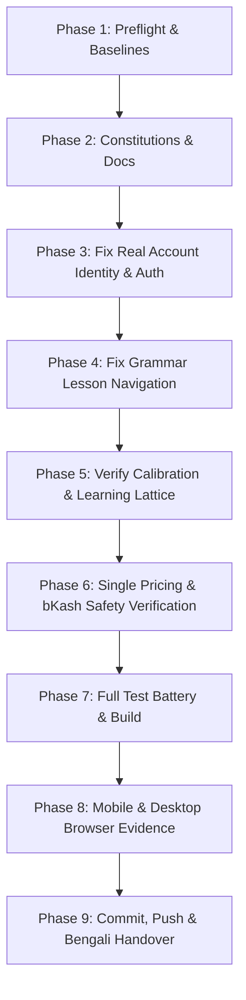

# NIHOMI.COM — PHASE 48 EXECUTION PLAN
## Learner Journey Constitution, Real Authentication, Evidence-Based Learning, Nomi Sensei, Payment Reliability, Mobile UX & Safe Production Release

**Document Version:** 1.0.0  
**Phase:** 48  
**Platform:** Antigravity 2.0  
**Working Branch:** `feature/visual-landing-rebuild-v2`  
**Latest Baseline Commit:** `9be4156`  
**Execution Order:** Dependency-Aware & Strictly Sequential (One Task at a Time)  
**Governing Rule:** `NO EVIDENCE = NO DONE`

---

## 1. OBJECTIVES & ROOT-CAUSE SCOPE

1. **P0: Fix Real Account Identity & Google Login**
   - **Root Causes:**
     - `src/components/auth/AuthModal.tsx` contains fallback code that sets `email: 'nihomibd@gmail.com'` when `loginWithGoogle()` fails or in quick student login.
     - `AuthContext.tsx` and `supabase.ts` have competing PKCE exchange: `supabase.ts` sets `detectSessionInUrl: true` while `AuthContext.tsx` also explicitly called `supabase.auth.exchangeCodeForSession(urlCode)`, resulting in code collision (`invalid_grant: code already used`).
     - Stale user state persisted in `localStorage` under `nihomi_user` without dynamic refresh on auth state change.
   - **Fix:**
     - Eliminate hardcoded `nihomibd@gmail.com` fallback in `AuthModal.tsx`.
     - Standardize PKCE exchange in `AuthContext.tsx`: ensure single canonical exchange handler.
     - Ensure thorough session cleanup on logout across `localStorage`, `sessionStorage`, and memory.
     - Distinctly label demo identities if demo login is used; real Google OAuth must dynamically pull user profile from authenticated session.

2. **P0: Fix Grammar Lesson Navigation Bug**
   - **Root Causes:**
     - In `src/views/LessonView.tsx` line 482: `if (selectedLessonNum === 1 && propLessonId !== 'n5-l2-words' && propLessonId !== 'lesson-02-words') return <ZenLearningCanvas ...>`
     - When any user clicked "Minna no Nihongo Lesson 1 Grammar Master" (passing `lessonId: 'n5-l1'` or `n5-l1-grammar`), `selectedLessonNum` evaluated to `1` and intercepted the request, rendering `ZenLearningCanvas` (the Hiragana vowels drawing canvas for `あ`) instead of the Minna no Nihongo Lesson 1 Grammar view.
     - In `src/core/curriculum/journeyEngine.ts` line 259: `isGrammarLesson = /^n5-l([2-9]|1\d|2\d)/i.test(normId) || normId.includes('grammar')`, which omitted `n5-l1`.
   - **Fix:**
     - In `LessonView.tsx`: `ZenLearningCanvas` must ONLY be rendered when `propChar` is specified (e.g. `char: 'あ'`) or when `propLessonId` specifically requests Kana vowel learning (`kana-a`, `kana-vowels`, `n5-kana-vowels`).
     - When a Grammar Lesson is requested (`n5-l1`, `n5-l1-grammar`, or `selectedLessonNum === 1` without `propChar`), render the complete Minna no Nihongo Lesson 1 Grammar Master curriculum.
     - Update `journeyEngine.ts` to recognize `n5-l1-grammar` and explicit grammar requests properly.

3. **P0: Formal Learner Journey Constitution & Cumulative Lattice Integrity**
   - Calibration evidence must persist per authenticated student (`nihomi_knowledge_state_<userId>`).
   - 5-vowel mastery correctly unlocks Ka-row (`kana-ka-family`).
   - Clicking Ka-row opens Kana Studio with `か` selected.
   - Lessons 1–5 remain strictly free; Chapters 6+ require Pro.
   - No untaught characters appear in learner-facing lessons or quizzes.

4. **P0: Single Canonical Pricing Funnel & Durable bKash Safety**
   - Maintain the streamlined single checkout modal in `CheckoutModal.tsx` (no duplicate 3-card grid or duplicate slideshow).
   - Verify payment idempotency, rate limiting, and fail-closed `NOT_CONFIGURED` state when credentials are absent.

5. **P1: Nomi Sensei Companion & Responsive Verification**
   - Integrate `NomiSenseiCompanion.tsx` seamlessly with `public/brand/nomi-sensei/nomi-sensei-primary.png`.
   - Validate responsive layouts at 360px, 390px, 768px, and 1280px.

---

## 2. DEPENDENCY-AWARE EXECUTION PHASES

---

## 3. ROLLBACK STRATEGY
- **Baseline Git Hash:** `9be4156` on `feature/visual-landing-rebuild-v2`
- All changes are atomic and localized to `src/components/auth/AuthModal.tsx`, `src/views/LessonView.tsx`, `src/context/AuthContext.tsx`, and documentation.
- If any regression occurs, individual files can be restored via `git checkout 9be4156 -- <filepath>`.
- Production branch `main` remains untouched.
