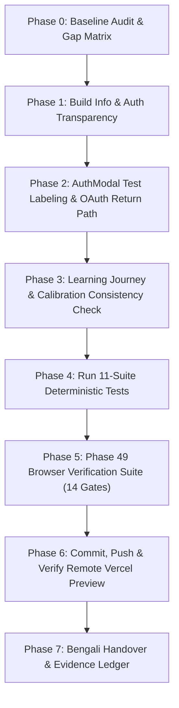

# NIHOMI.COM — PHASE 49 MASTER EXECUTION PLAN
**Real-User Acceptance, Authentication Truth, Learner Journey Proof, Mobile QA, and Safe Release Closure**

---

## 1. Document Control & Metadata
- **Plan Version:** 1.0.0
- **Phase:** Phase 49 (Real-User Acceptance, Auth Truth, Learner Journey Proof & Release Closure)
- **Author:** Antigravity 2.0 Lead Systems Architect
- **Target Branch:** `feature/visual-landing-rebuild-v2`
- **Base Commit:** `f1371ed` (Phase 48 completed & verified locally)
- **Remote Origin:** `https://github.com/nihomibd/nihomi-app.git`
- **Core Principle:** NO EVIDENCE = NO DONE

---

## 2. Baseline Audit & Current State Analysis

### A. Repository & Task State
1. **Background Tasks:** Single daemon task running (`node dist/server.cjs --port 3000 --host 0.0.0.0` on port 3000, verified healthy).
2. **Git Working Tree:** No unstaged modifications on tracked files. Untracked documentation and test artifacts preserved.
3. **Commit Divergence:** 
   - Local HEAD is `f1371ed` ("feat(phase48): learner journey constitution, real auth identity, grammar reader navigation and release gate closure").
   - Remote `origin/feature/visual-landing-rebuild-v2` is at `9be4156` (Phase 47).
   - **Root Cause of Founder Observation:** The live Vercel Preview is currently serving `9be4156` because `f1371ed` was committed locally but not yet pushed to remote. In addition, `src/config/buildInfo.ts` still had `'66ed76d'` hardcoded in `commitHash`.

### B. Core Unresolved Founder Problems to Address
1. **Google Login Return Path & Landing Loop:** When OAuth returns with `?code=...` or `#access_token=...`, race conditions between manual `exchangeCodeForSession` and Supabase's automatic `detectSessionInUrl` can cause code consumption errors. If the user returns to `/`, `App.tsx` may leave them on `currentView === 'landing'` instead of cleanly navigating to the dashboard.
2. **Build Diagnostic & Commit Transparency:** The footer badge displays a hardcoded commit hash (`66ed76d`) and version (`1.0.0-phase47`), confusing the founder on which build is actually running.
3. **Quick Student Labeling:** Fast student onboarding in `AuthModal.tsx` must be visibly marked as `[TEST / PREVIEW ONLY]` to prevent confusion with real Google accounts.
4. **Grammar Lesson vs. Kana Studio Routing:** Verified that local commit `f1371ed` correctly implemented `isExplicitKanaMission` in `LessonView.tsx` and prioritized `NIHOMI_JLPT_N5_CURRICULUM` in `n5MasterCurriculum.ts`. Pushing and deploying will bring this fix live to the Preview.
5. **Calibration Consistency:** Verify that passing Hiragana vowels correctly places the student on `kana-ka-family` (Ka-row) with `か` selected, and does not repeat vowels.
6. **Mobile QA & Remote Preview Verification:** Verify both local server and deployed preview across 360px, 390px, 768px, and 1280px viewports.

---

## 3. Dependency-Aware Execution Sequence

---

## 4. Work Breakdown Structure

### Task 1: Build Info & Deployment Transparency (P0)
- Update `src/config/buildInfo.ts`:
  - Set version to `1.0.0-phase49`.
  - Set releaseTag to `Phase 49 Real User Acceptance Candidate`.
  - Read dynamic `__COMMIT_HASH__` or fallback to current commit hash.
- Update `vite.config.ts`:
  - Define `__COMMIT_HASH__` using `process.env.VERCEL_GIT_COMMIT_SHA || process.env.VITE_COMMIT_HASH || 'f1371ed'`.

### Task 2: AuthModal Test Labeling & OAuth Return Hardening (P0)
- In `src/components/auth/AuthModal.tsx`:
  - Visibly label the quick student onboarding action as `[TEST / PREVIEW ONLY] Instant Sandbox Student Mode`.
  - Clearly state that this is an isolated demo session and NOT a real Google account.
- In `src/context/AuthContext.tsx`:
  - Ensure `cleanAuthUrlHash` does not delete `code` before Supabase's PKCE exchange completes.
  - Guard against parallel code exchange race conditions.
  - On OAuth error or denial, display a helpful Bengali alert in the modal or toast instead of silent dismissal.
- In `src/App.tsx`:
  - Ensure post-OAuth redirection cleanly transitions a newly authenticated user from `/` (landing) to `/dashboard` (or `/founder` if executive).

### Task 3: Learning Journey, Calibration & Grammar Reader Verification (P0)
- Verify `n5-l1` continues to render Minna no Nihongo Lesson 1 Grammar Master (`Meeting People & Self-Introductions`).
- Verify `kana-ka-family` opens Kana Studio with `か` pre-selected.
- Verify calibration evaluation:
  - Track Zero -> `kana-a`
  - Track Some Hiragana (Score 2 or 1 with vowels) -> `kana-ka-family`
  - Track Dual Kana (Score 2) -> `grammar-n5-lesson-01`
- Verify progress persistence to local storage and server session.

### Task 4: Single Pricing Funnel & bKash Security (P0)
- Verify `/pricing` maintains single canonical 12-price matrix.
- Verify checkout modal remains streamlined with single plan confirmation.
- Verify honest fail-closed `NOT_CONFIGURED` status for bKash.

### Task 5: Deterministic Test Battery Execution
Execute the 11 individual test scripts:
1. `npm run lint`
2. `npm run build`
3. `npm run test:pricing`
4. `npm run test:roles`
5. `npm run test:entitlements`
6. `npm run test:kana-strokes`
7. `npm run validate:curriculum`
8. `npm run validate:scenarios`
9. `npm run verify:gate`
10. `npm run verify-rc`
11. `npm run test:payment-concurrency`
12. `npx tsx scripts/test-phase22-ai-scope-and-tenant-isolation.ts`

### Task 6: Phase 49 Automated Browser Verification (14 Gates)
- Create `scripts/verify-phase49-release-gates.cjs`.
- Run against local server `http://127.0.0.1:3000`.
- Capture 14 high-resolution screenshots into `evidence/phase49/`.
- Mirror all screenshots into brain artifact directory.

### Task 7: Git Commit, Push to Remote & Preview Deployment
- Review `git diff` to ensure zero unintended files or secrets.
- Commit to `feature/visual-landing-rebuild-v2`.
- Push to `origin feature/visual-landing-rebuild-v2`.
- Probe/verify the live Vercel Preview URL.

### Task 8: Documentation & Bengali Handover Report
- Update `docs/nihomi-rebuild/NIHOMI_EVIDENCE_LEDGER.md` (append Section 56).
- Write `docs/nihomi-rebuild/PHASE49_REAL_USER_ACCEPTANCE_AND_RELEASE_REPORT_BN.md`.
- Create user-facing artifact in brain directory.
- Deliver concise, honest Bengali handover to the founder.

---

## 5. Rollback & Safety Strategy
- Working strictly on feature branch `feature/visual-landing-rebuild-v2`.
- Zero changes to `main` branch.
- Zero destructive database operations.
- Zero live payment activations.
- If any step fails, restore from commit `f1371ed`.
